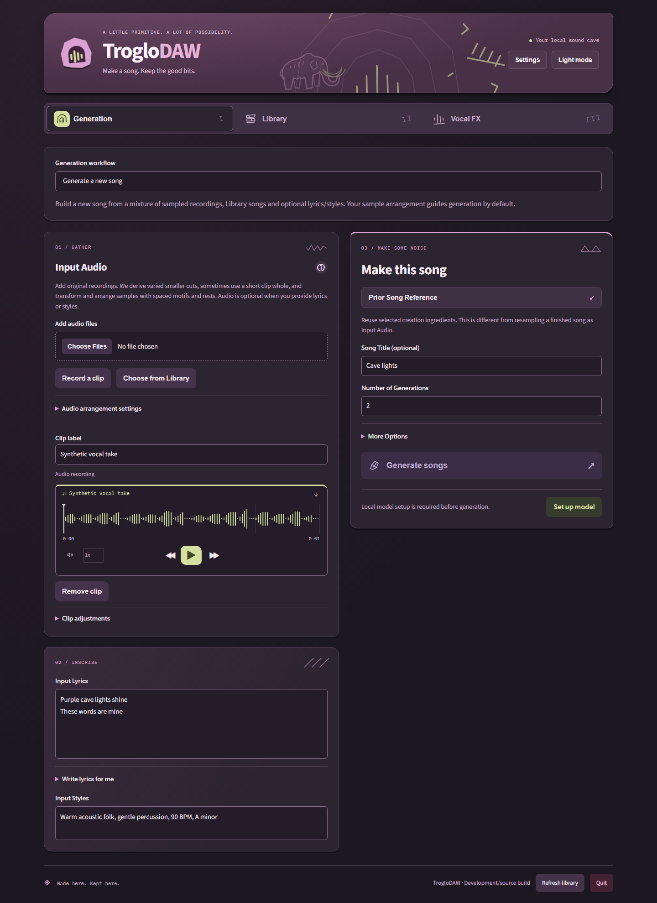
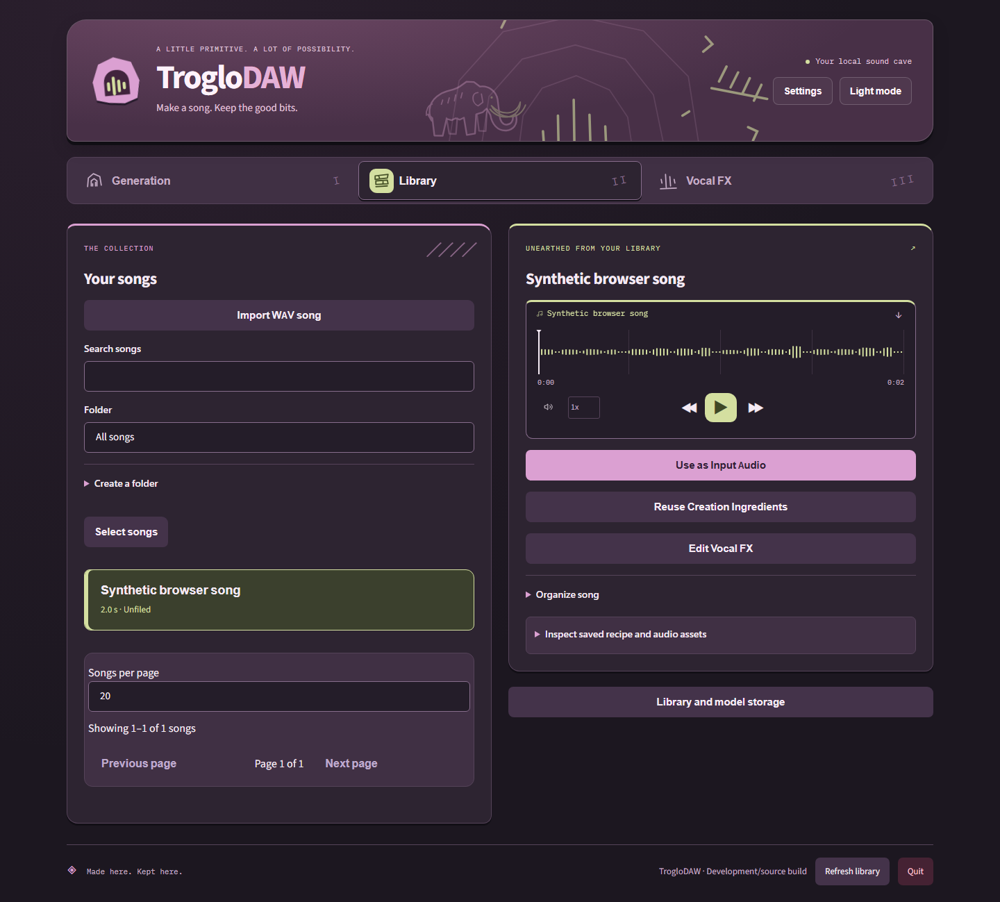
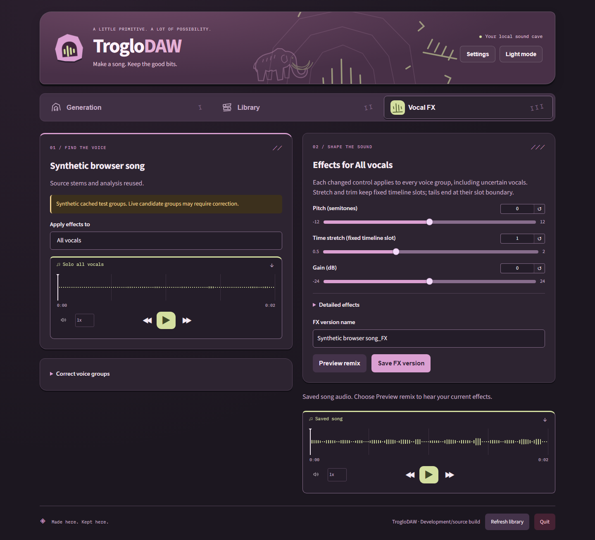

# TrogloDAW

A local music studio for turning your recordings, lyrics and ideas into songs.
Generate a new song from recordings and lyrics, arrange recordings over an existing
song, or reimagine one complete recording with style instructions. Keep a portable
library and shape voices on your own hardware, without sending audio to a remote service.

The design intent is **fully unfiltered local song generation**, inspired by
frustration with tightening song-creation restrictions in hosted tools such as
Suno. TrogloDAW adds no content moderation or word blacklists: your lyrics and
styles go to the local model without app-imposed censorship or content-based rewriting. Local models can still have learned biases and their own refusal behavior.
Technical input limits and imperfect model delivery still apply.

[Get the Windows installer](https://github.com/dalehayesiii/TrogloDAW/releases/latest) ·
[Song workflows](docs/song-workflows.md) · [Import and arrange over a song](docs/backing-arrangements.md) · [Model setup and hardware](docs/local-models.md) ·
[Lyrics and automatic length](docs/song-planning.md) · [Guide enhancement](docs/guide-enhancement.md) · [App updates](docs/updates.md) · [Installation and data recovery](docs/installation-recovery.md) ·
[All documentation](docs/README.md) · [Development](docs/development.md)

| App tab | Your next step |
| --- | --- |
|  **Generation** | Choose sampled song generation, a preserved backing with recordings, or Recording + style. Each keeps its own draft. |
|  **Library** | Import finished WAVs, play and reuse songs; [select multiple songs](docs/library-bulk-actions.md) to move or delete folder/search results together. Original audio, generated music and recipes stay together. |
|  **Vocal FX** | Extract vocals, review uncertain voice groups and apply effects while keeping the song's timing. |

## Inside the sound cave

Current compiled app, captured on 13 October 2026 in dark mode with a temporary
synthetic library. Models are not installed in this demonstration; Vocal FX uses
synthetic cached stems, not a separation-quality example. Light mode and system
appearance are available too.







Input audio yields varied phrase, motif and accent cuts; eligible short clips can also
contribute a whole-clip sample. Each cut receives bounded statement/response/fill
variations, with section dynamics, musical gaps and capped spaced returns before the
Base model generates around the full-song guide. These are local audio heuristics. Expand **Audio
arrangement settings** inside Input Audio to set **Audio adherence**, or enable
**Mix samples after generation** for independent music generation followed by a
sample overlay. The model can reinterpret samples; originals and the complete
arrangement remain available for inspection and portable replay.

Choose **Arrange recordings over an existing song** to keep a Library backing and
add a new sample arrangement without loading a music model. Imported WAVs can be
backings or prior songs. Model lyrics/styles stay in your draft when switching workflows.

Choose **Recording + style** for one complete upload/microphone recording with style
instructions and no lyrics, sample cuts or prior-song inputs. Each generation workflow
keeps its own draft. Compatible text-driven generation uses automatic musical metadata
planning when the optional tools are installed; source flows retain their own structure.
See [three-workflow validation and limits](docs/three-generation-workflows.md).

Long jobs show their active stage, completed work, elapsed time and separate
queue/current-song/whole-request time ranges. Estimates update from real work
events and recent comparable local runs; new workloads show **Estimating…**.
Progress stays visible across workflow changes and browser reloads. See
[progress and calibration](docs/progress.md) for measured accuracy and limits.

## Easiest: Windows installer

Run **`TrogloDAW-Setup-<version>.exe`**. Python is included and no admin rights are needed. It installs to
`%LOCALAPPDATA%\TrogloDAW`, adds **TrogloDAW** to the Desktop and Start Menu, and keeps your files in
`Documents\TrogloDAW\library` (set in `%LOCALAPPDATA%\TrogloDAW\app\config.json`). The app opens in your browser
and has no console window. **Quit** stops the app and replaces the page with a
confirmation that you can close the browser window. Initial setup installs the recommended
model into a folder you choose; weights are not bundled. Uninstall offers removal
of installed model assets checked by default, with an option to retain them. Uninstall from
Settings > Apps or the Start Menu. Your library is kept. Command line: `%LOCALAPPDATA%\TrogloDAW\troglodaw.bat <command>`.
Windows SmartScreen may warn because the installer isn't code-signed. Click *More info > Run anyway*.

The version in the filename distinguishes installers kept in the same folder.
Older apps need a one-time manual upgrade; see the
[versioned installer transition](docs/updates.md#recovery-and-limitations).

Closing the browser tab leaves the app and background work running. Launching the
desktop shortcut again reopens that same app, including when the default port was
occupied. Use **Quit** to stop it. Concurrent shortcut launches share one running
service; stale launch files after a crash do not prevent restarting.

First-run setup and **Settings** let you choose separate library and model folders,
including a different drive. Windows opens a folder browser. If the current folder
contains data, choose whether to move it, use the new folder without moving, or cancel.
The default model folder is `Documents\TrogloDAW\models`.
Model-generated songs use the verified ACE-Step 1.5 Base model and require a supported
NVIDIA GPU with 5.5 GiB free VRAM and 12 GiB available RAM. Allow about 19 GB for
model assets, inference wheels and caches; see the model guide for measured limits.
Fresh sampled drafts use automatic length, which needs the optional song writing
tools (about 4.91 GiB extra). Install those in Settings, or enter an explicit
10–300-second **Duration** under **More Options**. Recording + style and backing
arrangements use their source timelines instead.
After setup, model generation and fresh vocal extraction run locally offline.
Importing WAVs and arranging recordings over a backing work on CPU without model setup.
Choose **Continue in background** after starting installation to explore while it runs.
Installed builds check stable releases on startup; **Settings → App updates** offers
verified download and idle-only installation/restart. Setup and selected folders survive
updates. Fresh reinstall and retained-data instructions are in the recovery guide above.

## Run from source

Install [uv](https://docs.astral.sh/uv/getting-started/installation/) and Node.js
24.15 or newer. Source development targets Python 3.12, matching the embedded runtime;
uv can install that Python version automatically.

Windows: run **`scripts\launchers\start.bat`**. macOS/Linux: run
`bash scripts/launchers/start.sh` (or double-click `scripts/launchers/start.command`
on macOS). The launcher runs `uv sync --locked`, builds the Angular frontend if
missing, then starts FastAPI and opens **http://127.0.0.1:7860** (or the next free port).
The first setup needs internet. Leave the terminal open or use **Quit**.
After frontend source changes, run `npm run build` before relaunching.
The TrogloDAW Windows installer includes the compiled UI, Python and its own setup tool;
it needs no separately installed uv or Node. Generation needs verified initial
model setup and the supported hardware described in the model guide.

You don't need to install ffmpeg separately. A copy comes with the `imageio-ffmpeg` package.

## Where your files live

Source defaults to `library` next to the app; the installer defaults to
`Documents\TrogloDAW\library`. Settings can use an existing library or move the
current library to a new folder after copying and verifying it. Shared, changed
and unrelated files stay at the original location; existing destinations are not overwritten.
Keep the complete library together so saved recipes and audio remain portable:

```
library/
  voices/      imported voice recordings + FX'd versions (wav)
  music/       imported music tracks (wav)
  generated/   legacy procedural beats (wav)
  mixes/       mixes and remixes (wav + mp3)
  assets/      original inputs, samples, generated music and cached/edited vocals
  inbox/       recordings for the CLI command `troglodaw import --inbox`
  catalog.json id, name, type, duration, source, created, tags, recipe (paths relative to library/)
```

### Configuration

Settings are looked up in this order: **environment variables > `config.local.json` > `config.json` > built-in defaults**.

| Setting | Env var | Default |
|---|---|---|
| `library_dir` | `TROGLODAW_LIBRARY` | `library` (next to the app) |
| `host` | `TROGLODAW_HOST` | `127.0.0.1` |
| `port` | `TROGLODAW_PORT` | 7860, or the next free port |
| `ffmpeg` | `TROGLODAW_FFMPEG` | bundled `imageio-ffmpeg`, else `ffmpeg` on PATH |

`config.local.json` is for machine-specific values (library location, port, build paths) and is gitignored.
Copy `config/config.local.example.json` to root `config.local.json`. `TROGLODAW_CONFIG_DIR` changes where both config files are read from.
The browser Settings dialog manages library/model paths and verified model selection
without manual config edits. An explicit `TROGLODAW_LIBRARY` override takes precedence and
must be removed before changing the library through Settings. Appearance follows
the system by default; light/dark overrides persist and **Use system theme** resets them.
When you update the app, keep your library folder (or point `library_dir` at it).

## The web UI

- **Generation**: choose among [three input/output paths](docs/song-workflows.md#generation).
  Sampled generation supports recordings and Library priors, lyrics/styles,
  selective recipe reuse, automatic or 10–300-second length, and local lyric drafts.
  Fresh drafts request two sequential outputs. **Clip adjustments** affects only
  that sampled clip; **More Options** depends on the selected workflow.
  Recording + style takes one intact 1–300-second recording, with no lyric entry.
  The backing workflow uses the selected song's 1-second to 20-minute timeline.
- **Library**: play/search/rename songs, folders, recipe/audio-asset inspection, and
  direct actions to use rendered audio, reuse ingredients or edit voices.
- **Vocal FX**: local vocal extraction, uncertain candidate groups with correction,
  per-group effects and fixed-timeline remixing. Save a new FX derivative or update
  an existing one while preserving its source song and cached source stems.

[Detailed workflows and limits](docs/song-workflows.md). The original procedural
producer/generator/mixer remain available through the CLI for legacy recipes.

## Command line and recipes

The retained CLI imports, analyzes, synthesizes procedural beats, applies effects,
mixes and exports audio without a music model. It shares the browser’s library.
See the [CLI reference and procedural producer](docs/cli.md) for commands, examples
and recipe behavior.

Browser recipes retain original inputs, saved model/backing audio, transformed
samples, timing, options and model identity. Rerender uses these assets offline;
the same inference seed alone does not guarantee identical generated audio.
Vocal FX retains cached unprocessed stems so edits do not repeatedly bake earlier
effects into the source. Keep the complete library together when moving it.

## Building the Windows installer

Run `uv sync --locked`, `npm ci --ignore-scripts`, and `npm run build` first.
`scripts/windows/build.sh` makes a self-contained `TrogloDAW-Setup-<version>.exe` with embedded
Python, locked Windows wheels, bundled ffmpeg and the compiled Angular UI. It needs
NSIS (`apt install nsis` on Linux or `choco install nsis --version=3.11.0` on Windows),
Python and `curl`; Windows uses Git Bash. Linux cross-builds remain supported.
CI builds and tests the installed EXE together on Windows before any release.
Paths come from the `build` section of `config.local.json` (or `TROGLODAW_BUILD_*` env vars):
`venv`, `work_dir`, `cache_dir`, `output`, `parts_dir` (optional 15 MB split), `python_embed_version`.
Installer target paths are in the `windows` section (`install_dir`, `library_dir`, as NSIS variables).
`scripts/windows/wine_test.sh` provides the original optional Wine smoke test.
Packaging assets are under `cicd/windows/`; installer versions come from semantic-release.
See [CI workflow and tool rationale](docs/ci.md).

## Current limitations

If an older version made noisy audio with Weirdness above 50, see
[generation recovery](docs/generation-recovery.md) for the sampler fix and how to
regenerate an affected draft without changing existing songs.

- [Styling adherence](docs/style-adherence.md) documents supported controls and why captions are preserved.
- [Prompt-enrichment research](docs/prompt-enrichment-research.md) records instrumental, speech and content-preservation trials, including why the tested automatic writers were not enabled.
- Sampled model generation supports explicit 10–300 seconds or optional planned
  length; Recording + style uses its 1–300-second source length. Outputs run one at
  a time. Lyrics, style and vocal gender are model guidance; musical quality,
  exact sung words and vocalist character are not guaranteed. Model setup needs
  internet and disk space; CPU song generation is not a validated fallback.
- Vocal candidates are uncertain time groups, not guaranteed distinct singers.
  Overlapping singers can remain together; corrections change grouping rather
  than physically separating them. Review solo and remix previews before saving.
- Sampled generation arranges multiple inputs as model conditioning or an optional
  postmix overlay; the backing flow preserves existing music, and Recording + style
  conditions on one intact source. The app does not yet extract reusable instrument stems,
  provide MIDI export or automatically match inputs to the generated tempo/key.
- Arrangement and tempo/key detection are audio heuristics, with no guarantee of
  harmony, exact source words or artistic quality. The retained procedural CLI has
  separate [synthesis and effect limits](docs/cli.md#limits).

The download is `TrogloDAW-Setup-<version>.exe`. Default app/library roots use TrogloDAW;
the command is `troglodaw` and environment settings use `TROGLODAW_*`.
See the [product identity audit](docs/branding.md).

For an update that leaves the browser waiting or the launcher unable to reopen, see
[Windows update recovery](docs/update-recovery.md).
