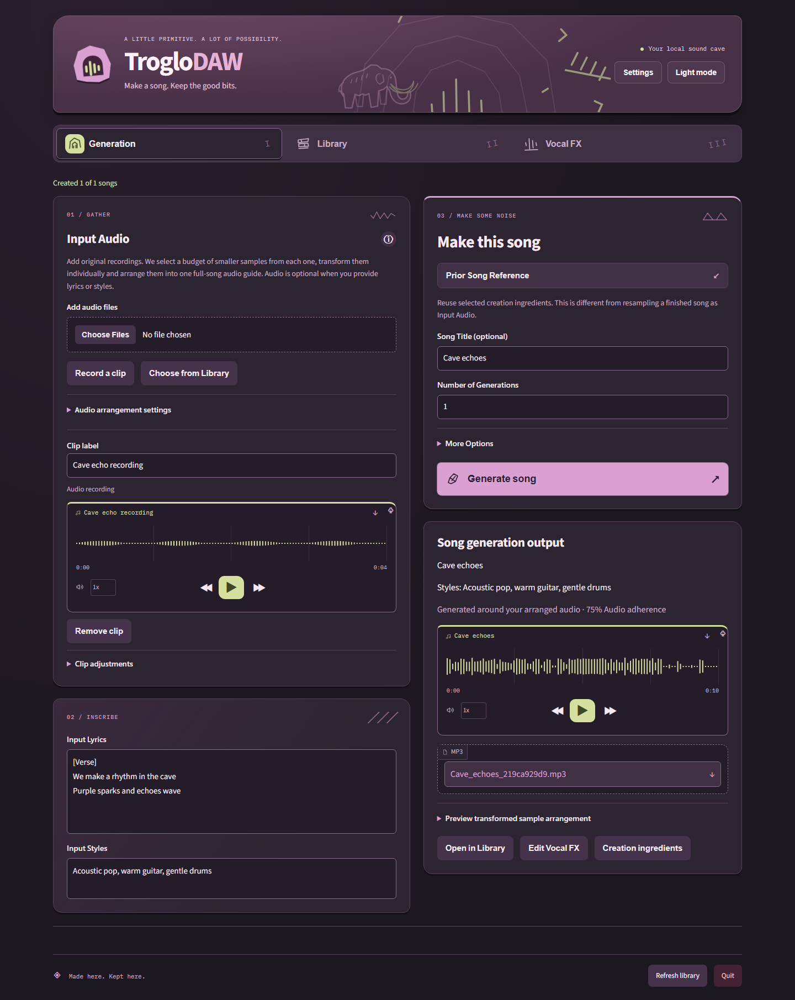
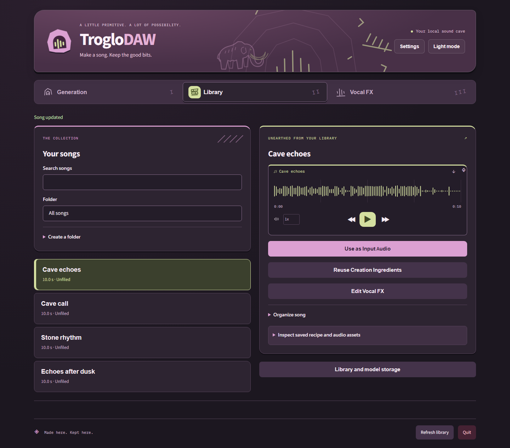
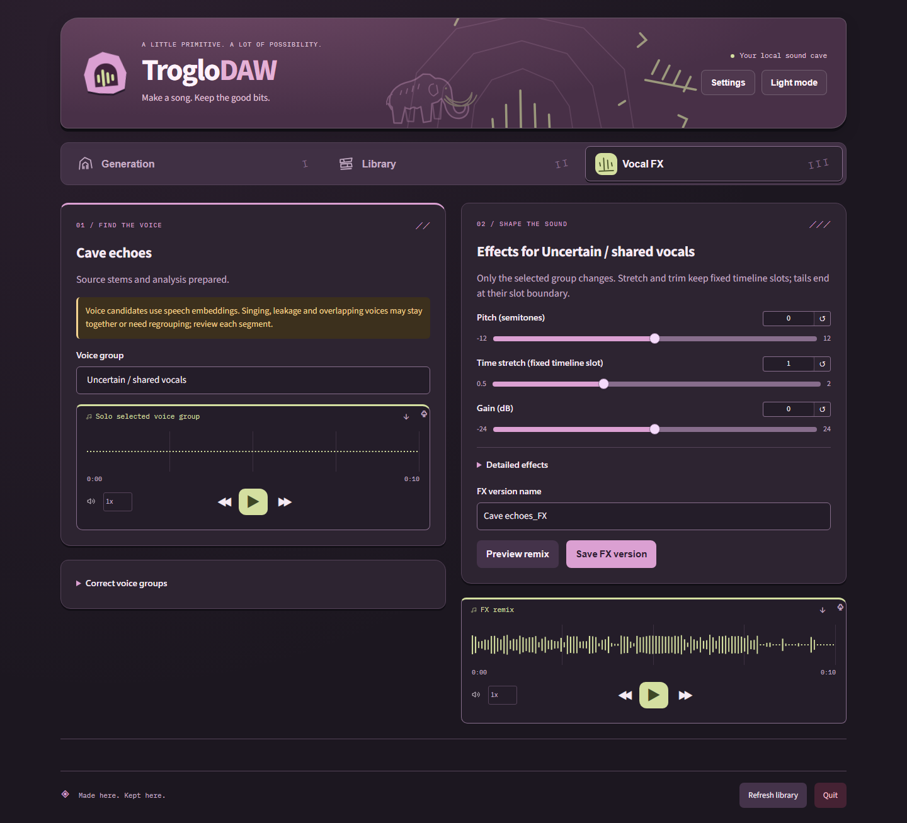

# TrogloDAW

A local music studio for turning your recordings, lyrics and ideas into songs.
Draft lyrics locally or enter your own, choose automatic length or up to five minutes,
and generate two independent songs sequentially by default. Generate on your own hardware, keep a portable song library and shape voices
without sending your audio to a remote service.

The design intent is **fully unfiltered local song generation**, inspired by
frustration with tightening song-creation restrictions in hosted tools such as
Suno. TrogloDAW adds no content moderation or word blacklists: your lyrics and
styles go to the local model without app-imposed censorship or content-based rewriting. Local models can still have learned biases and their own refusal behavior.
Technical input limits and imperfect model delivery still apply.

[Get the Windows installer](https://github.com/dalehayesiii/music-maker/releases/latest) ·
[Song workflows](docs/song-workflows.md) · [Model setup and hardware](docs/local-models.md) ·
[Lyrics and automatic length](docs/song-planning.md) · [Guide enhancement](docs/guide-enhancement.md) · [App updates](docs/updates.md) · [Installation and data recovery](docs/installation-recovery.md) ·
[Development](docs/development.md)

| Workflow | Your next step |
| --- | --- |
|  **Generation** | Add recordings, lyrics and styles. We derive smaller samples, transform each one and arrange a full-song audio guide for the model. |
|  **Library** | Play and reuse songs; [select multiple songs](docs/library-bulk-actions.md) to move or delete folder/search results together. Original audio, generated music and recipes stay together. |
|  **Vocal FX** | Extract vocals, review uncertain voice groups and apply effects while keeping the song's timing. |

## Inside the sound cave

The actual app in dark mode, using demonstration audio. Light mode and system
appearance are available too.







Input audio yields varied phrase, motif and accent cuts; eligible short clips can also
contribute a whole-clip sample. Each cut receives bounded statement/response/fill
variations, with section dynamics, musical gaps and capped spaced returns before the
Base model generates around the full-song guide. These are local audio heuristics. Expand **Audio
arrangement settings** inside Input Audio to set **Audio adherence**, or enable
**Mix samples after generation** for independent music generation followed by a
sample overlay. The model can reinterpret samples; originals and the complete
arrangement remain available for inspection and portable replay.

Long jobs show their active stage, completed work, elapsed time and separate
queue/current-song/whole-request time ranges. Estimates update from real work
events and recent comparable local runs; new workloads show **Estimating…**.
Progress stays visible across workflow changes and browser reloads. See
[progress and calibration](docs/progress.md) for measured accuracy and limits.

## Easiest: Windows installer

Run **`TrogloDAW-Setup-<version>.exe`**. Python is included and no admin rights are needed. It installs to
`%LOCALAPPDATA%\TrogloDAW`, adds **TrogloDAW** to the Desktop and Start Menu, and keeps your files in
`Documents\TrogloDAW\library` (set in `%LOCALAPPDATA%\TrogloDAW\app\config.json`). The app opens in your browser
and has no console window. **Quit** stops the app and replaces the page with a
confirmation that you can close the browser window. Initial setup installs the recommended
model into a folder you choose; weights are not bundled. Uninstall offers removal
of installed model assets checked by default, with an option to retain them. Uninstall from
Settings > Apps or the Start Menu. Your library is kept. Command line: `%LOCALAPPDATA%\TrogloDAW\troglodaw.bat <command>`.
Windows SmartScreen may warn because the installer isn't code-signed. Click *More info > Run anyway*.

The version in the filename distinguishes installers kept in the same folder.
Older apps need a one-time manual upgrade; see the
[versioned installer transition](docs/updates.md#recovery-and-limitations).

Closing the browser tab leaves the app and background work running. Launching the
desktop shortcut again reopens that same app, including when the default port was
occupied. Use **Quit** to stop it. Concurrent shortcut launches share one running
service; stale launch files after a crash do not prevent restarting.

First-run setup and **Settings** let you choose separate library and model folders,
including a different drive. Windows opens a folder browser. If the current folder
contains data, choose whether to move it, use the new folder without moving, or cancel.
The default model folder is `Documents\TrogloDAW\models`.
Generation uses the verified ACE-Step 1.5 Base model and currently requires a supported
NVIDIA GPU with 5.5 GiB free VRAM and 12 GiB available RAM. Allow about 19 GB for
model assets, inference wheels and caches; see the model guide for measured limits.
After setup, generation, vocal extraction and editing run locally offline.
Choose **Continue in background** after starting installation to explore while it runs.
Installed builds check stable releases on startup; **Settings → App updates** offers
verified download and idle-only installation/restart. Setup and selected folders survive
updates. Fresh reinstall and retained-data instructions are in the recovery guide above.

## Run from source

Install [uv](https://docs.astral.sh/uv/getting-started/installation/) and Node.js
24.15 or newer. Source development targets Python 3.12, matching the embedded runtime;
uv can install that Python version automatically.

Windows: run **`scripts\launchers\start.bat`**. macOS/Linux: run
`bash scripts/launchers/start.sh` (or double-click `scripts/launchers/start.command`
on macOS). The launcher runs `uv sync --locked`, builds the Angular frontend if
missing, then starts FastAPI and opens **http://127.0.0.1:7860** (or the next free port).
The first setup needs internet. Leave the terminal open or use **Quit**.
After frontend source changes, run `npm run build` before relaunching.
The TrogloDAW Windows installer includes the compiled UI, Python and its own setup tool;
it needs no separately installed uv or Node. Generation needs verified initial
model setup and the supported hardware described in the model guide.

You don't need to install ffmpeg separately. A copy comes with the `imageio-ffmpeg` package.

## Where your files live

Source defaults to `library` next to the app; the installer defaults to
`Documents\TrogloDAW\library`. Settings can use an existing library or move the
current library to a new folder after copying and verifying it. Shared, changed
and unrelated files stay at the original location; existing destinations are not overwritten.
Keep the complete library together so saved recipes and audio remain portable:

```
library/
  voices/      imported voice recordings + FX'd versions (wav)
  music/       imported music tracks (wav)
  generated/   legacy procedural beats (wav)
  mixes/       mixes and remixes (wav + mp3)
  assets/      original inputs, samples, generated music and cached/edited vocals
  inbox/       recordings for the CLI command `troglodaw import --inbox`
  catalog.json id, name, type, duration, source, created, tags, recipe (paths relative to library/)
```

### Configuration

Settings are looked up in this order: **environment variables > `config.local.json` > `config.json` > built-in defaults**.

| Setting | Env var | Default |
|---|---|---|
| `library_dir` | `TROGLODAW_LIBRARY` | `library` (next to the app) |
| `host` | `TROGLODAW_HOST` | `127.0.0.1` |
| `port` | `TROGLODAW_PORT` | 7860, or the next free port |
| `ffmpeg` | `TROGLODAW_FFMPEG` | bundled `imageio-ffmpeg`, else `ffmpeg` on PATH |

`config.local.json` is for machine-specific values (library location, port, build paths) and is gitignored.
Copy `config/config.local.example.json` to root `config.local.json`. `TROGLODAW_CONFIG_DIR` changes where both config files are read from.
The browser Settings dialog manages library/model paths and verified model selection
without manual config edits. An explicit `TROGLODAW_LIBRARY` override takes precedence and
must be removed before changing the library through Settings. Appearance follows
the system by default; light/dark overrides persist and **Use system theme** resets them.
When you update the app, keep your library folder (or point `library_dir` at it).

## AI Producer (one vocal in, finished song out)

The retained procedural producer is available on the command line:

```
troglodaw produce user_vocal_1                      # everything automatic
troglodaw produce my_take.m4a --mood chill          # import a file and produce it in one step
troglodaw produce user_vocal_1 --style trap --bpm 92 --key "C minor" --seed 42 --tune off
troglodaw analyze user_vocal_1                      # see what the producer hears
```

What it does, all offline with no API key (numpy/scipy/pedalboard):
1. **Analysis**:
   - tempo from onset-strength autocorrelation (spoken/rap vocals fold into 80-100 BPM, default 90)
   - sung vs spoken detection, f0 tracking and key estimation (Krumhansl-Schmuckler), with a reliability flag
   - silence-based phrase detection, BS.1770 loudness and an energy score
2. **Style and beat**:
   - style comes from energy (calm → lofi/ambient, mid → boombap, high → trap) unless you set a mood or style
   - an original beat in the chosen tempo/key with an intro (pad and hats), alternating verse A/B sections with crashes and fills, and a half-time outro
3. **Vocal chain**:
   - high-pass, noise gate, EQ, two-stage compression, normalize, light reverb and delay
   - gentle per-note pitch correction toward the key, only when the vocal is sung and the key is reliable (or `--tune on`)
4. **Arrangement**: phrases are grouped into 1-3 bar lines (chosen to minimise dead air) and each line starts on a downbeat after the intro. The music ducks under the vocal.
5. **Mastering**: bus compression and limiting to -14 LUFS integrated, with a true-peak ceiling of -1 dBTP (4x oversampled check). Output is wav + mp3 in `library/mixes`.

Each song is saved as a normal mix recipe (processed vocal + generated beat + settings + mastering) plus the full analysis,
choices and seed. `troglodaw remix <song> --music-vol -8` changes the balance and keeps the mastering.
`troglodaw rerender <song>` re-runs the whole producer with the same seed and gives the same song.

## The web UI

- **Generation**: multiple vocal uploads/recordings and prior-song samples, lyrics,
  styles, selective prior-recipe ingredients, title and independent output count.
  Each input's closed **Clip adjustments** dropdown changes only that clip's
  pitch, playback speed and volume before arrangement.
  More Options contains only Gender, Duration, Weirdness, Style Influence and Variety.
- **Library**: play/search/rename songs, folders, recipe/audio-asset inspection, and
  direct actions to use rendered audio, reuse ingredients or edit voices.
- **Vocal FX**: local vocal extraction, uncertain candidate groups with correction,
  per-group effects and fixed-timeline remixing. Save a new FX derivative or update
  an existing one while preserving its source song and cached source stems.

[Detailed workflows and limits](docs/song-workflows.md). The original procedural
producer/generator/mixer remain available through the CLI for legacy recipes.

## Command line

Source: `uv run --locked python backend/cli.py <command>` or the wrappers in
`scripts/launchers/`. Installed Windows: `%LOCALAPPDATA%\TrogloDAW\troglodaw.bat <command>`.
You can refer to items by id, a unique id prefix, or exact name.

```
troglodaw where                                   # show library + ffmpeg location
troglodaw demo                                    # end-to-end self test
troglodaw import rec1.m4a rec2.mp3 --type voice --tags take1
troglodaw import mybeat.mp3 --type music --name "my beat"
troglodaw import --inbox                          # import everything in library/inbox
troglodaw list [--type voice|music|generated|mix] [--tag X] [--json]
troglodaw show <id>                               # full catalog entry incl. recipe
troglodaw voice-fx <voice> --pitch -2 --reverb 0.3 --low-cut 100 --compress --name myvoice_fx
    # also: --stretch 0.9 --gain 3 --high-cut 8000 --chorus 0.4 --robot 0.6 --robot-hz 110
    #       --delay 0.3 --delay-time 0.35 --delay-feedback 0.4 --room-size 0.7 --trim --no-normalize
troglodaw generate --bpm 90 --key "A minor" --bars 8 --style boombap [--progression i-VI-III-VII] [--seed 42] [--swing 0.2]
troglodaw mix <voice> <music> --voice-vol 0 --music-vol -3 --offset 4 --duck --duck-db 8 \
       --fade-in 1 --fade-out 2 --loop [--voice-fx '{"pitch":-2,"reverb":0.3}'] --name mymix
troglodaw remix <mix> --music-vol -1 --offset 1.5 --duck-db 14 --voice-fx '{"robot":0.5}' [--voice <id>] [--music <id>]
troglodaw rerender <id>                           # rebuild any generated/fx/mix item from its recipe
troglodaw export <id> [--out DIR] [--formats mp3,wav] [--bitrate 256k]
troglodaw tag <id> a,b   |  troglodaw rename <id> "new name"  |  troglodaw delete <id>
troglodaw tts "some words"                        # test voice (espeak-ng if installed, otherwise a synthesized sung phrase)
```

Any setting can also be passed as `--set key=value` (for example `--set duck_threshold=-40`).
On Windows cmd, write JSON with escaped quotes: `--voice-fx "{\"pitch\":-2}"`.

## How recipes work

Legacy mixes store `voice_id`, `music_id`, and every setting. `remix` loads that recipe, applies your overrides
(you can even swap the voice or the music), renders a new mix, and records the `parent`. Generated beats store
their seed, so `rerender` reproduces them exactly. Browser-generated songs instead
retain the actual generated WAV, original inputs, transformed samples, timeline
placements, options and model identity. Rerendering uses saved assets offline;
running model inference again with the same seed does not promise identical audio.
Vocal FX recipes retain their source and cached unprocessed vocals so edits do not
repeatedly bake previous effects into the audio.

## Building the Windows installer

Run `uv sync --locked`, `npm ci --ignore-scripts`, and `npm run build` first.
`scripts/windows/build.sh` makes a self-contained `TrogloDAW-Setup-<version>.exe` with embedded
Python, locked Windows wheels, bundled ffmpeg and the compiled Angular UI. It needs
NSIS (`apt install nsis` on Linux or `choco install nsis --version=3.11.0` on Windows),
Python and `curl`; Windows uses Git Bash. Linux cross-builds remain supported.
CI builds and tests the installed EXE together on Windows before any release.
Paths come from the `build` section of `config.local.json` (or `TROGLODAW_BUILD_*` env vars):
`venv`, `work_dir`, `cache_dir`, `output`, `parts_dir` (optional 15 MB split), `python_embed_version`.
Installer target paths are in the `windows` section (`install_dir`, `library_dir`, as NSIS variables).
`scripts/windows/wine_test.sh` provides the original optional Wine smoke test.
Packaging assets are under `cicd/windows/`; installer versions come from semantic-release.
See [CI workflow and tool rationale](docs/ci.md).

## Current limitations

If an older version made noisy audio with Weirdness above 50, see
[generation recovery](docs/generation-recovery.md) for the sampler fix and how to
regenerate an affected draft without changing existing songs.

- [Styling adherence](docs/style-adherence.md) documents supported controls and why captions are preserved.
- [Prompt-enrichment research](docs/prompt-enrichment-research.md) records instrumental, speech and content-preservation trials, including why the tested automatic writers were not enabled.
- Browser song generation supports explicit 10–300 seconds or optional model-planned length with one local output running at
  a time. Lyrics, style and vocal gender are model guidance; musical quality,
  exact sung words and vocalist character are not guaranteed. Model setup needs
  internet and disk space; CPU song generation is not a validated fallback.
- Vocal candidates are uncertain time groups, not guaranteed distinct singers.
  Overlapping singers can remain together; corrections change grouping rather
  than physically separating them. Review solo and remix previews before saving.
- Browser Generation arranges multiple selected audio inputs alongside model audio.
  It does not yet extract reusable drums/bass/instrument stems from every song,
  provide MIDI export or automatically match inputs to the generated tempo/key.
- The retained CLI generator uses simple pattern-based synthesis. Legacy CLI mixes
  accept one voice and one music track; stack more by mixing a mix with another voice.
- The "robot" effect is a zero-phase robotizer, not a true carrier/modulator vocoder.
- There is no automatic tempo/key matching between a vocal and a track. Use offset, stretch and pitch by hand.
- AI Producer: it can't tell where words or beats fall, so phrases are placed by silence gaps. Free-tempo speech is placed line by line,
  not re-timed to the groove. Key detection on speech is unreliable, so spoken vocals get a beat rooted on the speaker's median pitch.
  Pitch correction is a gentle per-note nudge, not hard autotune. Style choice is a heuristic on energy and tempo.
- Pitch shift and time stretch quality is good for moderate amounts (about ±5 semitones, 0.75-1.3x).

The download is `TrogloDAW-Setup-<version>.exe`. Default app/library roots use TrogloDAW;
the command is `troglodaw` and environment settings use `TROGLODAW_*`.
See the [product identity audit](docs/branding.md).

For an update that leaves the browser waiting or the launcher unable to reopen, see
[Windows update recovery](docs/update-recovery.md).
