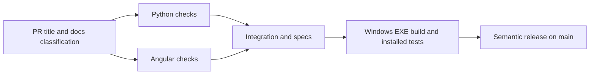

# TrogloDAW CI and releases

The first job uses [amannn/action-semantic-pull-request](https://github.com/amannn/action-semantic-pull-request)
for Conventional Commit PR titles and [dorny/paths-filter](https://github.com/dorny/paths-filter)
for changed paths, including both old and new names of renamed files. The small
docs-only condition is repository policy: a docs title cannot skip code checks by
changing executable files. An explicitly requested, labeled proposal may also
contain OpenSpec's change metadata YAML. Main uses the squash commit's title.
PNG/SVG documentation assets under `docs/` are approved docs-only paths alongside
Markdown; frontend/runtime assets and executable files remain code changes.

Python runs Ruff, ty and pytest. Angular runs Prettier, ESLint, Vitest and strict
production compilation, uploading its compiled UI. Integration runs synthetic
CLI/producer flows, tests release configuration and checks OpenSpec. Build restores
the compiled UI, installs hashed
Windows wheels into embedded Python, makes the EXE with NSIS and tests the actual
installed app with the full Playwright E2E suite and native upgrade/model-ownership tests.
Full browser tests run only in Windows build. There is one Python job and one Windows packaging job rather than
a Python OS matrix plus separate installer and Windows-test jobs.
Windows uses the runner's installed
Edge through Playwright's supported channel, avoiding another browser download.

GitHub jobs run on separate fresh machines. Each Node job needs its own `npm ci`
to provide its tools: Angular needs Angular/ESLint/Vitest, integration needs
OpenSpec/release plugins, build needs Playwright, release needs
semantic-release. Only Angular installs frontend workspace dependencies; other Node
jobs use `npm ci --ignore-scripts --workspaces=false`. Root `devDependencies` remain
installed because they contain the test and release tools. Each job runs installation
once and uses setup-node's npm download
cache. Caches do not share a ready-installed node_modules directory. Likewise,
Python environments are installed once per job with setup-uv caching. The compiled
frontend is shared as an artifact and is built only once per workflow.

`uv sync --locked` already checks lockfile freshness, so Python does not repeat
`uv lock --check`. PR Windows builds retain the preview installer, checksum and
manifest in `windows-build`. Only main archives the checked payload and uploads it
separately as `release-payload`; the publisher downloads only that payload, not
the preview installer it replaces. Both Windows artifacts use `compression-level: 0`
because the EXE and payload archive are already compressed.

Each job depends on its preceding stage using GitHub's built-in `needs` ordering.
The owner requires the five individual PR checks through GitHub branch protection;
there is no aggregate job or custom success checker. Valid docs changes skip
Python, Angular and build; integration still checks specs and release configuration.
No docs merge runs semantic-release or publishes assets. See the exact
[required status names](repository-settings.md).

Actions use explicit released version tags, with monthly Dependabot updates.
Version tags are readable but can be moved upstream; immutable commit pins were
the previous policy. The workflow follows the user's requested version-tag policy.

## Release behavior

After the same code/integration/build checks pass on main, the official pinned
[semantic-release CLI](https://github.com/semantic-release/semantic-release) selects
the next version. There is no custom planner. Defaults remain feat minor,
fix/perf patch, breaking code major and other nonbreaking types no release; docs
always have no bump. A main chore still gets a checked preview build, but no new
version is published unless earlier unreleased commits warrant one.

The official [exec plugin](https://github.com/semantic-release/exec) uses its
`prepare` lifecycle to pass `nextRelease.version` to NSIS. It repackages the already
checked payload, smoke-tests the resulting versioned EXE, then verifies source/version
and checksum before semantic-release creates the tag and publishes assets. This
second NSIS invocation is needed to put the official version into installer
metadata; it does not reinstall wheels or rebuild Angular. Preparation runs only
when semantic-release actually selects a release. PR builds use
`TrogloDAW-Setup-0.0.0.exe`. Published releases use
`TrogloDAW-Setup-<version>.exe`, with exactly that name in SHA256SUMS and
release.json. The publisher selects versioned EXEs and the guard rejects missing
or multiple matching installers before tagging.

The existing installer helper's `-ReleaseSmoke` mode verifies installation/shortcuts,
the displayed version against the manifest, embedded service health, the compiled
UI document and its JavaScript/CSS entry assets, and uninstall. It uses native
PowerShell HTTP requests rather than repeating Playwright, CLI/producer generation
or upgrade/model-ownership workflows. Windows build also exercises this smoke mode
against its preview EXE so PR checks validate the release path. Release retains
the unchanged checked app payload and the source/version/checksum guard.

Release-note generation uses all Conventional Commit types, including maintenance
and documentation, and the complete range since the previous tagged release. Notes
include a GitHub compare link covering every commit in that range. The preset is
pinned to a version compatible with the release-note writer; a regression test
renders the actual notes rather than just testing the version analyzer.

semantic-release pushes its tag before publishing GitHub release assets. The
publisher checks that reachable stable version tags already have published GitHub
releases. If publication previously stopped after tagging, the next run stops for
owner recovery instead of silently using that orphan tag as a changelog baseline.
Restore that release's checked assets/notes with owner help; do not delete or move
published tags to trigger releases. This preserves the range between successful
releases. The initial main attempt failed in note rendering before any tag was made.

## Why these custom files remain

| File | Project-specific contract | Reused tools underneath |
| --- | --- | --- |
| `scripts/check_specs.py` | Completed change must be archived in the implementation PR; proposal-only label is exceptional; no unfinished archived tasks | OpenSpec CLI separately validates spec structure; it does not enforce this delivery policy |
| `scripts/smoke_producer.py` | A synthetic vocal must produce a finished song in this app | TrogloDAW's own DSP/CLI |
| `scripts/windows/build.sh` | Assemble this app's embedded Python, static UI, licenses, ffmpeg and MSVC runtime | uv's locked export/hash/wheel installation, Python zipfile, NSIS |
| `scripts/windows/package.py` | Give NSIS the official version and checked payload with native arguments, then record the artifact | NSIS, Python subprocess, semantic-release exec, SHA-256 |
| `scripts/windows/test_installer.ps1` | Full installed-app/upgrade/ownership coverage in build; focused final-version installation, API/static UI and uninstall smoke in release | NSIS silent install, Playwright in build, native PowerShell HTTP in smoke mode |
| `scripts/windows/validate.py` | Existing embedded-bundle architecture/DLL/ffmpeg checks | pefile and packaging |
| `scripts/windows/cfg.py` / `make_icon.py` | Existing local build settings and TrogloDAW icon | Python JSON and Pillow |
| `scripts/build_manifest.py` / `release-guard.mjs` | Associate this EXE with checked source/version and reject changed/mismatched artifacts before tagging | SHA-256, Git, semantic-release prepare lifecycle |

The custom Python PR validator and custom next-version planner were removed.
Generic title, changed-path, dependency, test, spec-format and release behavior
use their maintained upstream tools; GitHub handles job ordering and required
statuses. Project-specific tests remain in
pytest/Playwright, rather than replacing either framework with custom CI logic.
