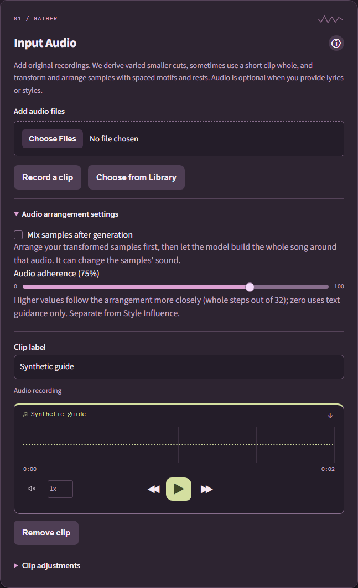
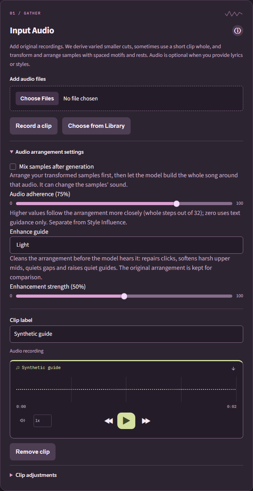
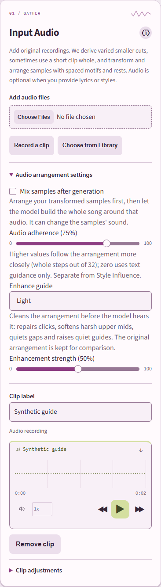

# Arrangement guide enhancement

Audio-conditioned generation sends the full-song sample arrangement (the *guide*)
to ACE-Step 1.5 Base. Guides are built from raw recordings with pitch, speed and
filter variations, so they are often quiet, harsh in the upper mids and carry the
recording's noise floor between phrases. **Enhance guide** prepares a cleaner copy
for the model. It never changes the arrangement's placements, the original inputs,
postmix output or text-only generation.

## Choices

Expand **Input Audio → Audio arrangement settings** (visible when clips are
selected and the model supports audio conditioning).

| Choice | What happens |
| --- | --- |
| Off | The model receives the arrangement unchanged. |
| Light (default) | Bundled local DSP: repairs isolated clicks, 70 Hz high-pass, softens harshness near 3.5 kHz, gentle compression, quiets gaps relative to the guide's own level, lifts quiet guides toward about −20 LUFS (at most +12 dB) and keeps the existing 0.8 peak ceiling. |
| AI clean | Reserved for a DeepFilterNet3 denoise add-on. **Unavailable in this version**; requests use Light and say so. |

**Enhancement strength** (0–100%, default 50%) scales the de-harsh depth,
compression ratio and gap reduction. 50% and above lift quiet guides to the target;
lower values lift proportionally less. 0% only repairs clicks and keeps headroom.
Processing time depends on guide length and the local CPU.

## Safety and provenance

If the enhanced guide contains invalid samples, becomes silent, or differs from the
original by more than about 8 dB (level-matched log-spectral distance), the model
receives the original guide instead and the job progress explains why.
The comparison combines stereo channel power so opposite-phase channels cannot
hide a large change. DSP or measurement failures, invalid measurements and shape
changes also fall back to the original guide instead of aborting generation.

This step does not enrich genre or instrumental prompts, add accompaniment or
rewrite lyrics. Speech, a cappella and no-music styling requests remain unchanged;
whether the music model follows them remains a separate model capability.

When enhancement is applied, the song's assets contain both
`sample-arrangement.wav` (what the model received) and `sample-arrangement.raw.wav`
(the original). The recipe records `guide_enhancement` (version, requested and
effective choice, strength, whether it was applied, any fallback reason and simple
loudness/spectral metrics) and the library-relative `conditioning_raw_file`.
Generation results show both guides under **Preview transformed sample
arrangement**. Prior Song Reference reuses the choice and strength with the other
generation controls. Older drafts without a saved choice use Light; older songs
and recipes are unchanged.

## Limitations and follow-up

- A fixed-seed RTX 3070 comparison used an invented vocal-like source and a
  20-second arranged guide with Base, seed 42, 32 ODE steps, guidance 8, shift 3
  and audio adherence 0.75. Both raw and Light-50 runs completed with finite
  20-second output and a 0.8913 peak. The guide rose from approximately −29.55 to
  −20 LUFS with 2.7 dB spectral distance. This verifies native integration, not
  better genre adherence or subjective musical quality. Choose Off to retain
  the raw character.
- AI clean is not shipped: DeepFilterNet 0.5.6 needs `deepfilterlib`, which has
  no Python 3.12 wheels (the Windows app embeds Python 3.12.10), pins numpy<2 and
  imports a torchaudio module removed in current releases. A follow-up should
  deliver it as an explicit, hash-verified model-manifest add-on installed from
  Settings into model storage (for example its ONNX models with a cp312 libDF
  build or equivalent feature extraction), never bundled in the installer, and
  offline after installation.
- Heavier restorers evaluated offline (Resemble Enhance, Apollo) were too slow on
  CPU or changed the voice too much for a conditioning guide.

## Review evidence

The corrected safety path covers measurement exceptions, invalid measurements,
changed shape and opposite-phase stereo. Real-service tests cover Off, Light,
saved settings, postmix hiding, fallback and portable replay. Desktop 1440px and
narrow 390px reviews in both themes found no horizontal overflow or obscured
enhancement controls. AI clean remains disabled and its limitation is explained
in the control's help; it is not represented as an installed capability.

Before:

After:

