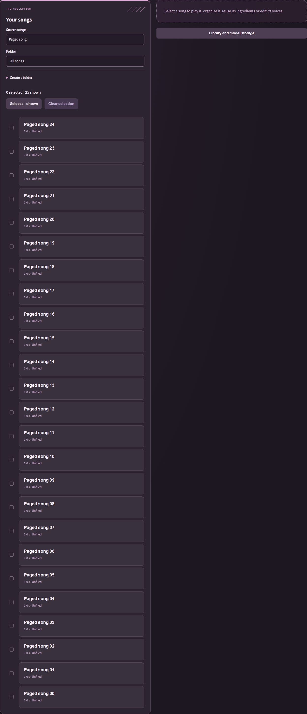
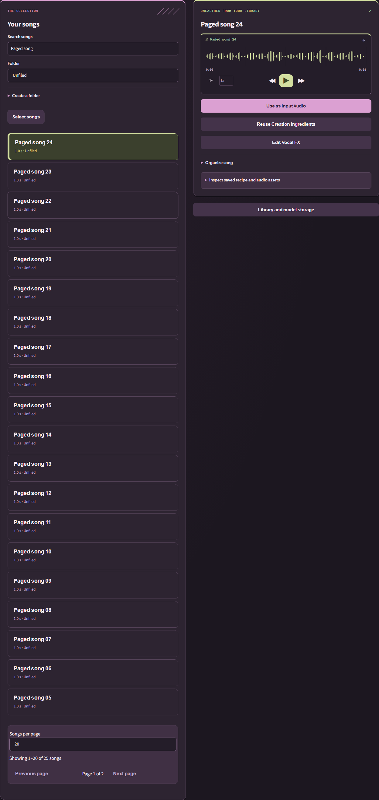
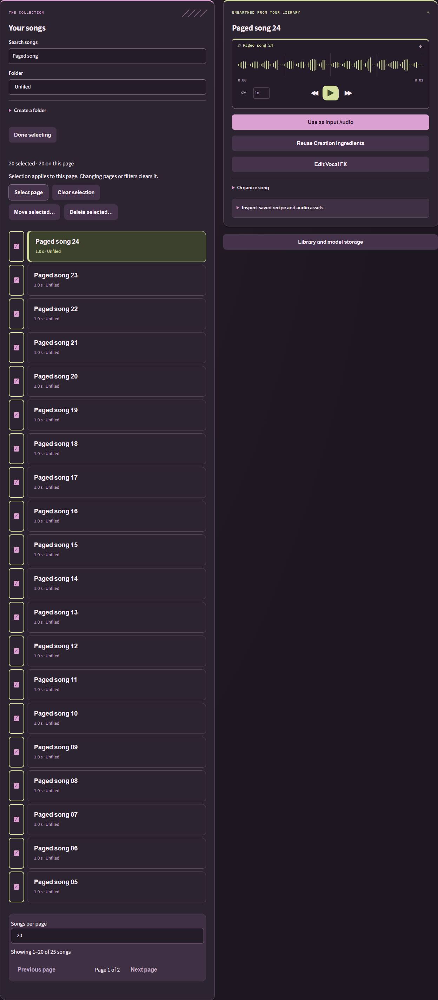
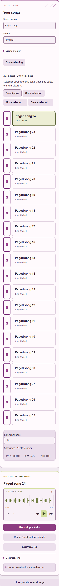

# Select and organize multiple songs

In **Library**, browse 20 songs per page by default; **Songs per page** offers
10, 20 or 50. The controls below the list show the result range and page count.
Search and folder filters apply to the whole library, returning to page one.

Press **Select songs** to reveal checkboxes and batch tools. Select individual
songs or **Select page**; only this page participates. Clicking a song title
still opens its independent playback preview. **Clear selection** clears checked
songs; **Done selecting** also hides selection controls. Changing the search,
folder, page or page size clears selection. Switching tabs keeps it; refreshing
removes missing or hidden songs and corrects the page after deletion. Reload
starts in ordinary browsing mode. Preview can remain open when changing pages.

**Move selected…** moves the selection to an existing folder, **Unfiled**, or a
new folder created in the same operation. These are logical folders inside Library,
not directories on disk. Audio paths, IDs, creation ingredients and FX lineage stay
unchanged. Moving the entire library to another drive remains a Settings action.

**Delete selected…** shows the exact count and names before confirmation. Cancel
keeps everything. Confirmation deletes selected catalog entries and their unshared
managed WAV/MP3 files; other songs and saved recipe/FX assets remain. Files outside
managed library storage are protected. Deletion is permanent, not a recycle-bin
operation. Bulk controls are disabled while processing.

If a file is locked or an item fails, the result reports how many songs were deleted
and identifies the failures in a persistent dismissible Library notice. Failed and
unprocessed songs stay selected for retry. Retrying clears the previous Library
notice; successful operations use the usual expiring toast. Cancellation between
songs keeps completed deletions and leaves the rest intact.

## Interrupted deletion recovery

During deletion, audio is temporarily renamed beside its original path to
`.troglodaw-delete-<32-character-id>-<original-filename>`. Ordinary file/catalog
failures restore those names before reporting failure. An abrupt process/Windows
shutdown can interrupt this step. Close TrogloDAW and back up the library before
manual recovery: if `catalog.json` still references the original filename, rename
the corresponding temporary file back to that name without overwriting another
file. If the catalog entry was successfully deleted, the temporary file is leftover
cleanup and can be removed. Cleanup failures also identify retained filenames in
the Library notice. Do not delete whole asset/cache folders as a recovery shortcut.

## Usability evidence

The list follows [Carbon pagination anatomy](https://www.carbondesignsystem.com/building-blocks/core/components/pagination/guidelines)
with range, page count, size choice and boundary-disabled navigation below the list.
[Carbon batch actions](https://www.carbondesignsystem.com/building-blocks/core/components/data-table/guidelines)
inform the contextual toolbar; the explicit Select songs entry is TrogloDAW's
requested adaptation. Playback and checkboxes keep separate click targets.

Review found two usability issues: always-visible checkboxes crowded browsing
(minor), and unbounded selection did not communicate page scope (major). The
selection entry and page-scoped controls resolve both. Desktop (1440px) and narrow
(390px), both themes, have no horizontal overflow. Real-service synthetic tests
cover multiple pages, search across the catalog, folder/size resets, exact-page
bulk deletion, last-page correction, mode exit/reload, independent preview,
confirmation cancellation, preserved recipes and partial failure/retry.
Pagination bounds visible rows; it does not reduce the catalog API payload.

Before:

After, ordinary browsing:

Selection mode:

