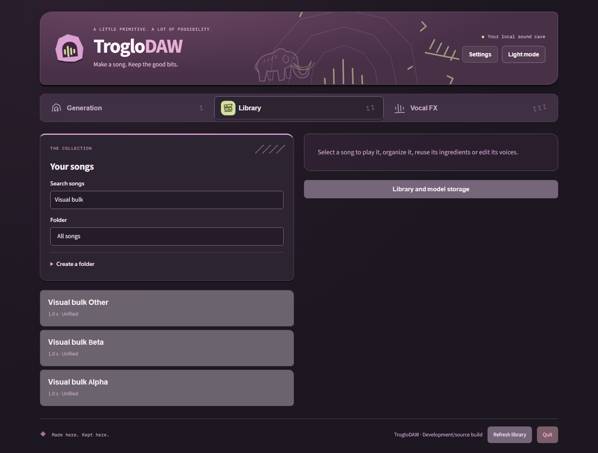
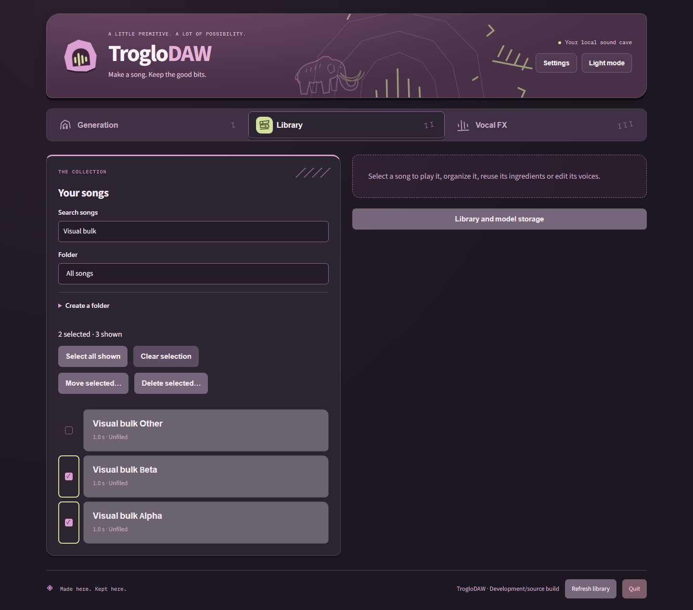
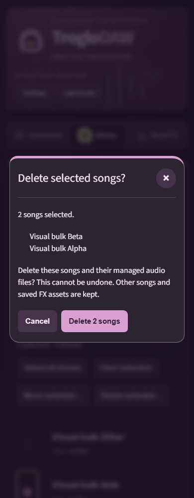

# Select and organize multiple songs

In **Library**, use the checkbox beside each song, or **Select all shown** to select
the current folder/search results. The count above the list shows selected and
visible songs. Clicking a song's title still opens its playback preview without
changing the checkboxes. **Clear selection** resets the checkboxes. Changing the
search or folder also clears selection, so bulk actions never include hidden songs.
Switching tabs keeps selection; refreshing drops missing or no longer shown songs.

**Move selected…** moves the selection to an existing folder, **Unfiled**, or a
new folder created in the same operation. These are logical folders inside Library,
not directories on disk. Audio paths, IDs, creation ingredients and FX lineage stay
unchanged. Moving the entire library to another drive remains a Settings action.

**Delete selected…** shows the exact count and names before confirmation. Cancel
keeps everything. Confirmation deletes selected catalog entries and their unshared
managed WAV/MP3 files; other songs and saved recipe/FX assets remain. Files outside
managed library storage are protected. Deletion is permanent, not a recycle-bin
operation. Bulk controls are disabled while processing.

If a file is locked or an item fails, the result reports how many songs were deleted
and identifies the failures in a persistent dismissible Library notice. Failed and
unprocessed songs stay selected for retry. Retrying clears the previous Library
notice; successful operations use the usual expiring toast. Cancellation between
songs keeps completed deletions and leaves the rest intact.

## Interrupted deletion recovery

During deletion, audio is temporarily renamed beside its original path to
`.troglodaw-delete-<32-character-id>-<original-filename>`. Ordinary file/catalog
failures restore those names before reporting failure. An abrupt process/Windows
shutdown can interrupt this step. Close TrogloDAW and back up the library before
manual recovery: if `catalog.json` still references the original filename, rename
the corresponding temporary file back to that name without overwriting another
file. If the catalog entry was successfully deleted, the temporary file is leftover
cleanup and can be removed. Cleanup failures also identify retained filenames in
the Library notice. Do not delete whole asset/cache folders as a recovery shortcut.

## Usability evidence

Synthetic real-service browser checks cover visible selection, playback independence,
new/existing folder semantics, persistence, delete cancellation, deletion of the
previewed item, partial failure and retry. Desktop (1440px) and narrow (390px) reviews
cover both themes and centered confirmation dialogs. Review found no horizontal
overflow; the checkbox label provides a 44px-wide click target. Selection controls
and songs are kept within the same Library card, and preview responses are ignored
when another song has since become selected.

Before:

After:

