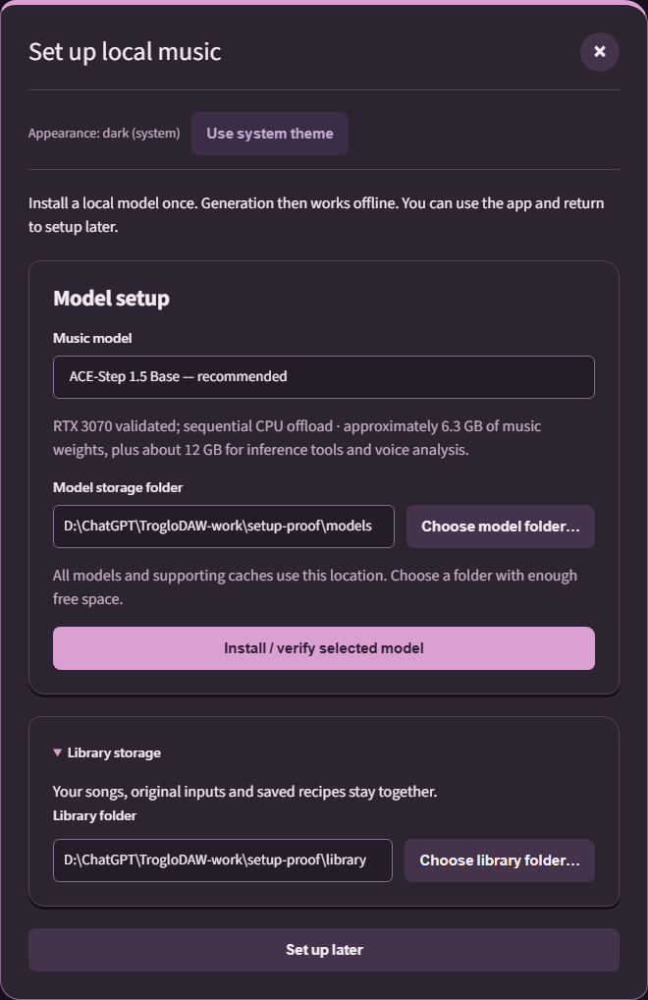

# TrogloDAW Local model setup and measured limits

Generation uses ACE-Step 1.5 Base locally. The Windows installer contains the
browser interface, Python, core DSP and the pinned uv setup tool; it does not
contain model weights. First-run setup offers explicit model installation; Settings
provides the shared folder/model controls afterward. Upgrades reuse setup history;
fresh reinstalls select retained folders again. See [installation recovery](installation-recovery.md).
Choose the model folder with **Choose model folder…** before installing. Windows
opens a native folder browser; cancel keeps the current location. The same controls
are available later in **Settings**, including **Choose library folder…** under
Library storage. Source platforms without this picker expose a collapsed manual
path fallback. By default the model folder is `models` beside the
configured library (Windows: `Documents/TrogloDAW/models`). Library and model
storage may use different drives. All provider/runtime caches follow the model
folder. No cloud generation, audio upload or API key is involved.

## Acquisition and retention

`config/model-manifest.json` records exact URLs, revisions, lengths and SHA-256
checksums for music weights, encoder/tokenizer, decoder, separation weights,
speaker assets and upstream inference code. Setup verifies existing files before
reuse, resumes partial HTTP downloads, rejects checksum failures and preserves
existing files with different contents. It activates a model only after all
assets and the isolated locked runtime pass verification and an offline import
probe. Canceling or failing an optional installation retains the working choice.
Generation disables Hugging Face/Transformers networking and upstream implicit
model acquisition. Runtime dependencies are pinned in `pyproject.toml`/`uv.lock`;
setup creates a temporary hashed export and installs Windows CUDA wheels into the
chosen folder. Node is not an installed runtime dependency.

The Base default needs approximately 6.35 GB of music assets plus 0.42 GB of
separation/speaker assets; allow another 12 GB for inference wheels and caches.
Settings also offers the architecture-compatible SFT checkpoint. SFT is not
separately benchmarked. Turbo is excluded because it overrides classifier-free
guidance and would make Style Influence ineffective.

When the current location contains models or library data, selecting another folder
prompts **Move existing data**, **Use folder without moving**, or **Cancel folder
change**. Moving copies only managed data, hash-verifies it, commits the new location
and removes unchanged originals individually. Shared, changed and unrelated files
remain at the old location; a populated destination is never overwritten. Failure
before the location commit keeps the original active. Libraries keep portable recipes
and existing playback links. Using a folder without moving leaves the original data
there and verifies/reuses compatible assets during model setup. Installing/verifying
the selected model is a separate action after choosing the destination. The legacy
CLI/API relocation mode retains a recovery copy. The app
cannot change a library location while an explicit `TROGLODAW_LIBRARY` override applies.
Uninstall offers **Remove installed model assets**, checked by default. Cleanup
removes only unchanged files recorded as owned by this installation, including
owned runtime/cache files. Other installations' references, externally supplied
files, changed files and unrelated contents are preserved. Libraries remain.
Unchecking the option (silent uninstall: `/KEEP_MODELS`) retains assets. Upgrades
preserve preferences and model files. Setup never recursively deletes the chosen
model root. Manually changed assets require a separate folder or explicit repair.

## Setup progress and time remaining

The top line shows local start time and combined download/installation remaining time.
Overall/current-stage bars describe Download until model-file bytes are present, then
switch to Installation. Download ranges adapt to measured speed; installation counts
completed verification/runtime checkpoints rather than elapsed-time percentages.
Destination, current-file bytes, resumption and verified-file count remain visible.
Unknown dependency-install work stays indeterminate. Compatible successful local
runs progressively improve whole-setup estimates. See [progress and measured
accuracy](progress.md).

After starting installation, **Continue in background** closes first-run setup safely.
Keep the app running; importing, recording, playback, library browsing and draft editing
remain available. New generation and fresh extraction wait for a ready compatible model.

## Validated configuration

Measured on 2026-10-12, Windows, NVIDIA RTX 3070 8 GiB, driver 617.14, ordinary
desktop/display activity running, Python 3.12, PyTorch 2.7.1+cu128. No dedicated
full-desktop control or physical microphone was needed. Pinned upstream code:
`ca1e85fe9430179831e6bc6be790c332190a3866`; Base checkpoint:
`e432212fec32b8965a14ffa57ae653438d6abd14`; common encoder/decoder:
`19671f406d603126926c1b7e2adc169acbcade22`.

One output at a time, BF16 CUDA/SDPA, CPU and DiT offload, 32 inference steps,
music generation without concurrent planner/LM, compilation or quantization. Generation requires 5.5 GiB free CUDA
memory and 12 GiB available system RAM before loading. CPU generation is not a
validated fallback and fails clearly rather than substituting a procedural beat.
Supported explicit lengths are 10–300 seconds, with no silent truncation. Optional local song writing tools select automatic length and draft editable lyrics; see [song planning](song-planning.md).

| Output length | Whole subprocess | Model generation | Peak CUDA allocation |
| --- | --- | --- | --- |
| 10 s | 29.41 s | 15.19 s | 4.52 GiB |
| 60 s | 47.05 s | 28.84 s | 4.59 GiB |
| 120 s | 44.73 s | 29.94 s | 4.69 GiB |

These are individual observed runs with the clean, locked installed Windows
runtime and outbound socket connections blocked, not calibrated ETA promises.
The pinned checkpoint uses an older misspelled CFG argument; a checked compatibility
adapter maps the runtime parameter explicitly. With the same seed/caption, CFG 8
versus 1 changed waveform RMS by 0.168, Weirdness 50 versus 90 by 0.347, and
male versus female caption guidance by 0.169. This demonstrates active conditioning,
not an objective claim about musical quality or guaranteed vocal classification.
The later [sampler correction](generation-recovery.md) keeps ODE across the whole
Weirdness range; the old above-50 SDE path had an incompatible timestep schedule.
The real browser also completed N=2 with independently cataloged recipes containing
original input, transformed sample assets and placements. The 120-second
run used a parent-and-child RSS sampler and peaked at 11.03 GiB. Earlier RAM
samples measured only the venv redirector and are intentionally excluded. All
120-second audio chunks contained nonzero signal; exported duration matched the
request. Whisper tiny.en research transcription recovered the requested two lyric
lines in both clean 10-second vocal-character examples and their extracted/overlaid
vocal streams. ASR checks demonstrate lyric intelligibility, not reliable singer
identity or an independent listening-quality score. Longer examples repeated the supplied material and
contained recognition/pronunciation variations. Lyrics are passed unchanged and
retained exactly in recipes; acoustic verbatim delivery is not guaranteed.

HDemucs separation plus ECAPA candidate grouping on a generated 10-second lead
completed in 8.20 seconds; an overlay of two generated vocal songs took 5.91 seconds.
Both peaked at 0.67 GiB CUDA allocation and about 1.98 GiB process RSS. With CUDA
hidden, the validated 8-second CPU fallback took 7.25 seconds and 1.81 GiB RSS.
Identity reconstruction maximum error was below 3e-8 on all three examples.
Both lead and overlap examples yielded four time-partitioned candidates despite
only one/two intended lead voices. Candidate count is not a singer count. This
measured fragmentation is why grouping is explicitly uncertain and correctable. Separation uses CUDA
when at least 2 GiB is free, otherwise CPU; groups use CPU embeddings. Singing,
backing voices and overlapping singers may remain together or split into several
candidates. Every candidate is labeled uncertain. Segment correction changes
grouping, not the physical separation of overlapping singers. Solo and remix
previews are necessary before accepting edits. Bypass reconstruction uses the
exact residual `original - extracted vocals`, rather than adding edited voices
on top of a mix containing the original vocals.

## Audio-conditioned generation validation

The Base model supports a complete source arrangement through `task_type=cover`,
`src_audio` and `audio_cover_strength`, as documented in the
[official inference API](https://github.com/ace-step/ACE-Step-1.5/blob/main/docs/en/INFERENCE.md).
Only the tested Base checkpoint advertises this capability; the unbenchmarked SFT
alternative uses the clearly explained postmix fallback. No extra download is
needed for Base conditioning. Text guidance, unchanged lyrics and the existing CFG
compatibility mapping remain active.

Offline embedded-Python RTX 3070 tests used fixed seed 42, CFG 8 and 32 steps with
known synthetic/generated input assets. A full-duration arrangement at 0%, 75% and
100% adherence succeeded. The 75%-versus-zero waveform difference RMS was 0.2163;
changing the arrangement at the same 75% strength changed the output by RMS 0.1709.
The 75%-versus-100% adherence difference was RMS 0.0764.
These differences demonstrate active conditioning, not a perceptual quality score.

| Arrangement/output duration | Total time | Inference time | Peak process RSS | Peak CUDA allocation |
| --- | --- | --- | --- | --- |
| 10 s, 75% | 30.27 s | 14.64 s | 11.02 GiB | 4.69 GiB |
| 60 s, 75% | 36.45 s | 21.56 s | 11.05 GiB | 4.76 GiB |
| 120 s, 75% | 47.88 s | 30.00 s | 11.13 GiB | 4.86 GiB |

The first cold 10-second run took 79.33 seconds including initialization; these
single-run measurements are not calibrated ETAs. All outbound sockets were denied
in the inference harness. Normal display/desktop use remained active.

The pinned checkpoint repeats its cover-to-text conditioning switch on every
remaining step, doubling CFG tensors repeatedly. A narrow verified-source adapter
changes that switch to happen once, in memory; it never edits downloaded code or
weight files. Regression tests and actual zero/partial/full-adherence runs cover
this repair. Unrecognized incompatible code fails clearly.

The arrangement uses audible phrase/energy/spectral-diversity heuristics and a
shared rhythmic grid. The model may reinterpret or blur sample identity, timbre,
words or structure. Adherence rounds down to whole conditioning steps out of 32 and preserves both
requested and effective values. Higher adherence is influence, not a guarantee of exact sample
preservation. Use the optional post-generation mix when exact arranged samples
should remain audible over independently generated music. Both modes preserve
original inputs, individual cuts and complete arrangement audio for inspection.

## Runtime and asset licenses

The app acquires pinned inference code and model files explicitly after installation.
Upstream [ACE-Step repository](https://github.com/ACE-Step/ACE-Step-1.5/blob/main/LICENSE)
and [Base checkpoint card](https://huggingface.co/ACE-Step/acestep-v15-base) specify MIT; model implementation
files retain their Apache-2.0 headers. [Qwen encoder assets](https://huggingface.co/Qwen/Qwen3-Embedding-0.6B) specify Apache-2.0.
SpeechBrain ECAPA assets specify Apache-2.0. Torchaudio/Demucs code specifies BSD/MIT
respectively. Upstream notices remain in installed runtime source/wheels and the
verified archive; inspect each repository/card before redistributing changed assets.
Dependencies and optional weights are separate from the core Windows installer.

Primary sources: [ACE-Step inference](https://github.com/ACE-Step/ACE-Step-1.5/blob/main/docs/en/INFERENCE.md),
[GPU compatibility](https://github.com/ACE-Step/ACE-Step-1.5/blob/main/docs/en/GPU_COMPATIBILITY.md),
[common model card](https://huggingface.co/ACE-Step/Ace-Step1.5),
[ECAPA model card](https://huggingface.co/speechbrain/spkrec-ecapa-voxceleb),
[Demucs license](https://github.com/facebookresearch/demucs/blob/main/LICENSE).
