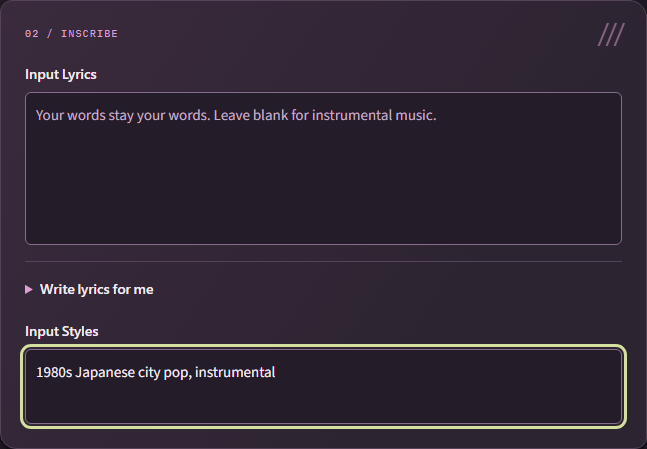
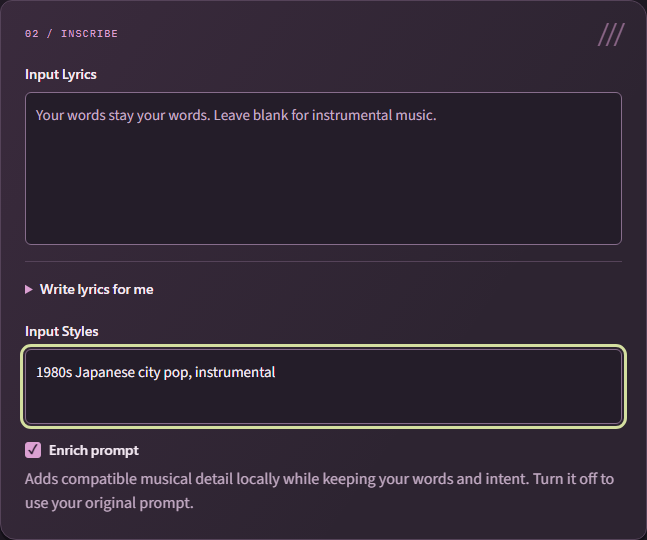

# Prompt enrichment: instrumental detail and intent preservation

## Decision

The October 2026 investigation for WRK-24 did not establish a safe, reliable
default-on enrichment method. The tested writers sometimes changed the requested
genre, added vocals to instrumentals, invented speech topics or rewrote supplied
words. The app therefore keeps original styling authoritative and supplied lyrics
literal. No experimental writer, new compulsory model download or ineffective
“Enrich prompts” checkbox is shipped from this study.

The initial study was a limited evaluation of three pinned model identities and six protocols,
not a conclusion that prompt enrichment cannot work. The desired improvement in
instrumental genre fidelity remains unproven. A larger or specialized checked local
writer is a possible subsequent investigation. The requested
experience remains one automatic toggle; no suggestion-review workflow is planned.

One concrete app defect was repaired: Variety used to append acoustic accents,
choruses and bridges regardless of the request. Its bounded additions now vary
dynamics, phrasing, timing, tone, texture or flow **within the requested mood,
style, rhythm, delivery, sources or form**. Zero still passes styles through.
Original/effective prompts, literal lyrics and the `requested-performance-v1`
identity are retained in each output's recipe. Existing songs replay unchanged.
This removes an app-created contradiction; it does not prove better audible genre
adherence or guarantee that ACE can produce pure speech.

## Mechanisms and primary evidence

ACE's [official tutorial](https://github.com/ace-step/ACE-Step-1.5/blob/main/docs/en/Tutorial.md)
separates global caption conditioning from temporal lyric/performance structure.
Concrete instrument roles, groove and production descriptions can express intent,
but conflicting directions can compete. The
[inference API](https://ace-step.github.io/ACE-Step-1.5/en/INFERENCE) exposes caption
formatting and independent generation controls; an exposed feature alone does not
establish that automatic rewriting preserves requests. The
[ACE-Step 1.5 paper](https://arxiv.org/abs/2602.00744) describes the architecture.

The upstream [adherence report](https://github.com/ace-step/ACE-Step-1.5/issues/424)
includes wrong genres, language and topics from the music planner. It supports
testing that planner before reuse, rather than assuming it behaves like a general
instruction writer. It is an issue report, not a controlled quality benchmark.

We separately tested the existing instruction writer and a larger general writer.
[Qwen3-1.7B's model card](https://huggingface.co/Qwen/Qwen3-1.7B) documents Apache-2.0
licensing and thinking/non-thinking operation. The
[Qwen3 report](https://arxiv.org/abs/2505.09388) describes that model family. Neither
source demonstrates preservation of music-specific exclusions for this product.
No moderation prompt, profanity filter, remote generation service, genre keyword
dictionary, unverified adapter or additional runtime dependency was introduced.

The [ACE model card](https://huggingface.co/ACE-Step/Ace-Step1.5) and
[code license](https://github.com/ace-step/ACE-Step-1.5/blob/main/LICENSE) identify
MIT licensing; the [Qwen3-0.6B card](https://huggingface.co/Qwen/Qwen3-0.6B) identifies
Apache-2.0, as does Qwen3-1.7B. Licensing compatibility did not establish prompt
quality, and the larger Qwen weights remain a research-only download.

## Models, protocol and fixtures

All inference ran offline on an RTX 3070 with local verified weights, sequentially,
using invented requests. Research weights, caches, logs and temporary outputs were
kept on D: separately from personal app data. The existing pinned Transformers
runtime was reused with BF16 CUDA inference and eight CPU threads.

| Identity | Pinned revision | Use |
| --- | --- | --- |
| ACE-Step integration | `ca1e85fe9430179831e6bc6be790c332190a3866` | Existing formatter/automatic-duration action and locked music-planner assets in `config/model-manifest.json` |
| Qwen/Qwen3-0.6B | `c1899de289a04d12100db370d81485cdf75e47ca` | Existing local lyric writer; separate joint and caption-only trials |
| Qwen/Qwen3-1.7B | `70d244cc86ccca08cf5af4e1e306ecf908b1ad5e` | Research-only general instruction writer; not the ACE 5Hz music planner |

The ACE music-planner weights come from the locked `ACE-Step/Ace-Step1.5`
revision `19671f406d603126926c1b7e2adc169acbcade22`, distinct from the integration
code revision above. Existing asset hashes remain in the app's manifest.

The larger writer's two weight shards totaled 4,063,515,592 bytes (3.78 GiB).
Their verified SHA-256 hashes were
`169ad53ec313c3a34b06c0809216e4fc072cce444a5d4ff2b59690d064130ed5`
and `912becff8d60672aa8628ef08c05898d9adf17c2ad4ae3caf99b065622fdeff9`.
Tokenizer/config assets were pinned and locally recorded with hashes too. These
are research costs, not a change to the app's installation requirements.

The eight fixtures were:

| Case | Original styling | Supplied words |
| --- | --- | --- |
| City pop | 1980s Japanese city pop, instrumental | Blank |
| Solo instrument | solo baroque harpsichord, no drums, no other instruments, instrumental | Blank |
| Speech | political speech, dry spoken voice, no singing, no music, no instruments | Those corrupt bastards stole our wages. We refuse to bow. |
| A cappella | a cappella, solo baritone, no instruments, no backing music | The night is dark. I will not forgive. |
| Sparse | sparse dark ambient, quiet evolving drones, no drums, no vocals | Blank |
| Industrial | industrial punk, distorted synth bass, hard mechanical drums, aggressive vocals | Fuck their empty promises. We will not kneel. |
| Japanese speech | 政治演説、話し声だけ、楽器なし、音楽なし、歌わない | 私たちは黙りません。 |
| Salsa | salsa, prominent piano montuno, congas, brass, dance rhythm, instrumental | Blank |

Each protocol explicitly required genre/instrument/language/exclusion preservation,
no new subject matter, sparse output to remain sparse, speech to remain spoken,
and no instruments for vocal-only requests. Joint rewriting additionally demanded
verbatim lyrics, including profanity and negative sentiment. Caption-only protocols
kept all supplied words outside the writer; they were never candidates for replacement.

| Protocol | Requests | Generation settings |
| --- | --- | --- |
| Existing ACE formatter | 8 | Native `plan_song`, seed 42, existing constrained metadata decoding, temperature 0.85 |
| Qwen 0.6B joint caption/lyrics JSON | 7 | Non-thinking, greedy, seed 42, max 512 new tokens |
| Qwen 0.6B caption only | 8 | Non-thinking, greedy, seed 42, max 256 new tokens |
| Qwen 0.6B sampled expansion | 8 | Non-thinking, temperature 0.7, top-p 0.8, top-k 20, seed 42, max 256 new tokens |
| Qwen 1.7B expanded caption | 16 | Same sampled settings, seeds 42 and 71, 35–65 words and at most 400 characters requested |
| Qwen 1.7B additive JSON | 8 | Thinking, temperature 0.6, top-p 0.95, top-k 20, seed 42, max 1536 new tokens; original kept verbatim, additions limited to 150 characters |

The joint trial saved seven valid experiment records; console encoding failed
while printing the Japanese result, so salsa was not evaluated in that protocol.
Subsequent trials used UTF-8 console output. Do not count that missing case as a
pass or a model failure.

## Observed preservation failures

| Candidate | Concrete observation | Decision |
| --- | --- | --- |
| ACE formatter | Solo harpsichord became flute/piano chamber music; sparse dark drones became piano/strings/choir and a hopeful climax; Japanese speech became J-rock instrumentation | Reject automatic caption substitution; continue consuming validated duration metadata only |
| Qwen 0.6B joint writer | Industrial lyrics gained new lines despite a verbatim requirement | Reject lyrics rewriting |
| Qwen 0.6B caption only | Mostly copied the input or changed punctuation | No demonstrated enrichment gain |
| Qwen 0.6B sampled expansion | Salsa acquired spoken/no-instruments/no-music directions | Reject despite useful-looking output in other cases |
| Qwen 1.7B expanded caption | Both city-pop seeds added vocal delivery; speech invented political themes; seed 71 a cappella added classical/19th-century styling; four of sixteen captions exceeded 400 characters | Reject default-on expansion; truncating would risk losing constraints |
| Qwen 1.7B additive JSON | Five outputs repeated constraints or returned no additions; city pop added a pop-rock groove; industrial added effects without demonstrated audio benefit | No reliable improvement established; do not enable automatically |

Illustrative exact outputs from the larger writer:

- Instrumental city pop, seed 71: “Focus on a slow, nostalgic groove with a warm, melodic vocal delivery.”
- Political speech, seed 42: “Focus on a specific political theme, such as social justice, economic inequality, or environmental concerns.”
- A cappella, seed 71: “The style should be classical, 19th-century, with a melancholic mood”.
- Additive city pop, seed 42: `{"additions":"pop-rock groove with lead guitar and bass, sparse synths, 80s city pop vibe"}`.

These are synthetic model outputs, not user recordings. Keeping the original text
as a prefix did not prevent incompatible extra directions. An unrestricted lyric
writer also cannot be trusted merely because its instruction says “preserve”.

## Measured costs and limits

| Protocol | Minimum / median / maximum inference seconds | Peak PyTorch allocated GiB |
| --- | --- | --- |
| ACE formatter | 8.47 / 11.63 / 13.73 | 3.50 |
| Qwen 0.6B joint | 1.53 / 1.89 / 3.39 | 1.15 |
| Qwen 0.6B caption only | 0.75 / 0.83 / 1.11 | 1.15 |
| Qwen 0.6B sampled | 0.48 / 0.88 / 2.28 | 1.15 |
| Qwen 1.7B expanded | 1.69 / 3.44 / 5.12 | 3.25 |
| Qwen 1.7B additive | 17.66 / 20.02 / 43.92 | 3.37 |

Times exclude model loading. Allocation is not total driver/desktop VRAM. The
measurements are local observations, not product ETA calibration or broad hardware
benchmarks. Fifty-five text transformations were examined; this small suite is
sufficient to show observed counterexamples, not to estimate general failure rates.

The candidates failed the text-preservation gate before an audio/listening
comparison could justify activation. No blind listening score or improved genre
fidelity is claimed, and no rejected caption was used to assert an audio benefit.
Guide-cleanup A/B tests are a separate DSP investigation and cannot supply evidence
for prompt enrichment.

## Gate for a subsequent implementation

An eligible per-model/revision profile must first preserve literal supplied words,
language, genre, mood and all positive/negative musical constraints across multiple
seeds, including speech and non-song cases. Only then compare unchanged/enriched
audio with matched music seeds and settings, blind listening, instrumental character,
genre adherence and vocal/lyric fidelity scored separately.

If that comparison establishes a benefit, the intended product layer should retain
unchanged editor inputs, inspectable original/effective prompts, explicit bypass,
once-per-request enrichment, clear original-prompt fallback and portable provenance.
Optional assets need explicit verified setup; unexplored music models receive no
enhancement. Coordinate source-aware work with WRK-9. Enrichment must never become
a content filter or a compulsory backing-track generator.

## Follow-up: guarded 7B candidate, 13 October 2026

A separate prototype evaluates a single automatic toggle with bounded additive
directions and original-caption fallback. It is **not in the released app**. The
music runtime's fingerprint remains unchanged, and support acquisition is separate
from music readiness. This avoids making already installed music unavailable merely
because enrichment support is missing. The prototype never downloads during generation.

| Research identity | Pinned revision/version | Role |
| --- | --- | --- |
| Qwen/Qwen3-4B-Instruct-2507 | `cdbee75f17c01a7cc42f958dc650907174af0554` | Rejected additive proposals and compatibility-check trials |
| Qwen/Qwen2.5-7B-Instruct | `a09a35458c702b33eeacc393d103063234e8bc28` | Candidate local additive writer and compatibility check |
| bitsandbytes | `0.50.2`, official Windows wheel | NF4 double quantization, BF16 compute |
| laion/clap-htsat-unfused | `8fa0f1c6d0433df6e97c127f64b2a1d6c0dcda8a` | CPU-only development evaluator; not a proposed app dependency |

The 4B writer proposed city noise, inappropriate instrument techniques and visual
speech directions; its short critic accepted some known contradictions. The 7B
CPU/GPU/disk configuration was stopped after about 373 seconds without a first usable
proposal. Standard GPU quantization was practical: observed loads ranged roughly
18–75 seconds, with approximately 5.43 GiB peak Torch allocation. These are local
observations, not total driver use or latency promises. Writer weights occupy
15,242,805,751 bytes (14.20 GiB), in addition to the existing music installation.

Ungated 7B prose still invented city noises and inappropriate additions. A binary
critic missed an impossible playing-technique fixture in one protocol and rejected
valid instrumentation in another. The later prototype checks a bounded JSON conflict
record, accepting only an explicit `ACCEPT` with an empty conflict. Invalid, truncated,
oversized, rejected or empty responses retain the original direction. Lyrics remain
outside the writer; only delivery/source context accompanies the original caption.
An asserted absence of conflict is empirical model behavior, not a formal semantic
guarantee or a content-moderation decision.

The complete short-description pipeline processed 20 invented requests at seeds
42 and 71, including solo harpsichord/banjo/kazoo, quiet jazz, sparse ambient, speech
in English/Japanese, profanity/politics, vocal-only chant and broad music genres.
Restricted requests generally fell back or received compatible limited detail.
Held-out conflict checks included impossible techniques, excluded accompaniment,
unwanted lyrics/topics, another genre, extraneous noises and excessive density.
Conservative false rejections remain a limitation. A native production-worker trial
reproduced the city-pop proposal in 50.91 seconds, including 48.03 seconds loading.
Fresh locked support installation added only bitsandbytes, without another Torch copy.

### Matched-seed audio comparison

An initial prose candidate produced three 30-second original/enriched pairs at seed
42. CLAP similarity against the **original** caption changed as follows: city pop
0.3738→0.4024, detailed salsa 0.5990→0.5227, and sparse ambient 0.3874→0.3510. That
candidate was not activated.

The complete short-description candidate then produced ten 30-second pairs across
five broad styles and two music seeds. Base used the same pinned runtime, 32 ODE
steps, guidance 8, shift 3 and blank lyrics for both sides. These comparisons isolate
caption additions; optional musical metadata blueprints were absent. CLAP ran on CPU,
averaging fixed 0–10, 10–20 and 20–30 second windows against the original captions.

| Original style | Seed 42 original → enriched | Seed 71 original → enriched |
| --- | --- | --- |
| 1980s Japanese city pop, instrumental | 0.3738 → 0.3796 | 0.4153 → 0.4025 |
| salsa, instrumental | 0.1684 → 0.6523 | 0.4067 → 0.5825 |
| 1970s funk, instrumental | 0.4676 → 0.4676 | 0.6727 → 0.6727 |
| dark ambient, instrumental | 0.4129 → 0.3343 | 0.4078 → 0.3445 |
| bluegrass, instrumental | 0.6190 → 0.5419 | 0.5853 → 0.6278 |

Four pairs improved on this proxy, four worsened and two used unchanged original-
caption fallback. Mean difference was +0.0476, driven by salsa; the median difference
was zero. Eighteen actual renders served the ten pairs because rejected funk additions
reused the identical baseline. This is semantic similarity, **not a listening score,
percentage improvement, instrumental-presence rating or proof of better songs**.
No human blind-listening result has been received. One Windows worker access violation
occurred during text-encoder offload; the identical isolated retry passed. The failure
was retained and its cause is not claimed resolved.

These results support a potential benefit for some requests, especially the tested
salsa captions, but do not establish reliable improvement across genres. The profile
remains inactive. The user requested a **draft, work-in-progress PR** on 13 October
2026 so the prototype and evidence can be reviewed while improvements continue.
That request does not activate the candidate, qualify its mixed results or authorize
merging this draft. It is not marked complete or released.
No per-genre keyword workaround or hidden multiple-render reranking was introduced.

### Why the additional download, and what can be reused?

The 14.20 GiB is the pinned writer's original on-disk weight/config/tokenizer set,
not its GPU requirement. This prototype quantizes those weights to NF4 when loading;
it does not download a prequantized checkpoint. The candidate actually ran on the
local RTX 3070: the production-worker trial took 50.91 seconds including 48.03 seconds
loading, with approximately 5.43 GiB peak Torch allocation. That measurement excludes
driver/desktop allocations and does not guarantee the same performance on every run.
The writer exits before music generation starts.

Existing Torch/Transformers packages are reused. Reusing the installed Qwen 0.6B
lyric writer or ACE 1.7B planning model for this task was tested first; their observed
limitations are recorded above. These results reject the tested protocols, rather
than proving smaller models can never work. The ACE audio generator is a different
kind of model and is not an interchangeable general-purpose text writer.

The 7B download is a research choice, not an essential product requirement. Before
qualification, evaluate better reuse protocols, smaller writers and a verified
prequantized checkpoint that could reduce disk/download size. No smaller replacement
or prequantized distribution has yet passed the same preservation, native-runtime
and matched-audio checks. The draft leaves the profile inactive and does not add
these experimental downloads to a released installation.

### Draft UI evidence

These are actual compiled Angular components using a synthetic local-service fixture,
with the same city-pop request before and after the prototype. The toggle is the
only additional editor control; generated production directions are not displayed.
This UI evidence does not imply that the candidate is qualified or released.

Before:

After:

Primary implementation references:
[Qwen2.5 model card](https://huggingface.co/Qwen/Qwen2.5-7B-Instruct),
[official bitsandbytes installation](https://huggingface.co/docs/bitsandbytes/main/installation),
[CLAP model card](https://huggingface.co/laion/clap-htsat-unfused) and
[CLAP paper](https://arxiv.org/abs/2211.06687).
