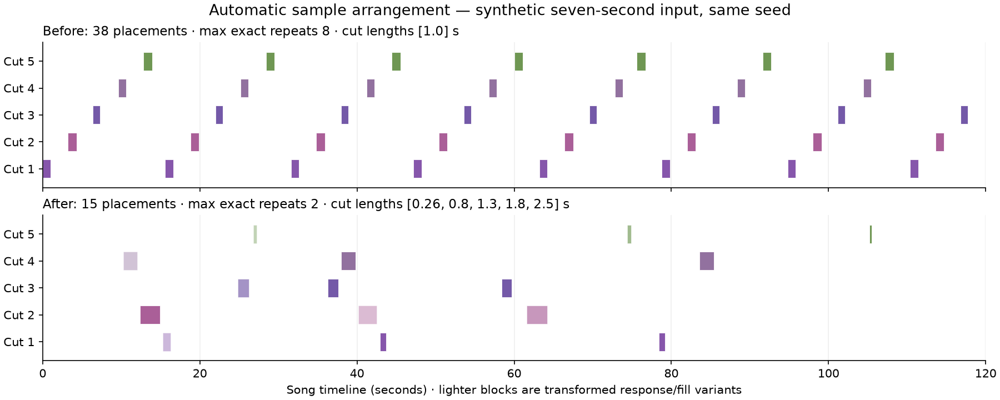

# Automatic sample arrangement validation

The `phrase-motifs-v2` planner replaces uniform cycling of short cuts with mixed-length
source phrases, motifs and accents, up to three bounded transformations per cut, and
section-based placement with rests and limited returns. Original audio is preserved;
conditioned and postmix generation share the same guide. See
[song workflows](song-workflows.md) for controls and limits.

## Synthetic before and after

This comparison uses an invented seven-second signal with three changing tonal
phrases, short articulation gaps, default clip settings, seed 42 and a 120-second
guide. The earlier implementation is the main revision preceding this correction;
the corrected comparison uses the actual `Songs.arrange` path. No personal audio is
included. Rectangles show actual saved placements, colored by distinct cut family.
Lighter rectangles are transformed response/fill variants.

| Measurement | Earlier planner | Corrected planner |
| --- | --- | --- |
| Distinct source cuts | 5 | 5 |
| Cut lengths (seconds) | All 1.00 | 0.26, 0.80, 1.30, 1.80, 2.50 |
| Saved transformation variants | 5 | 15 |
| Placements across 120 seconds | 38 | 15 |
| Highest exact-variant repeat count | 8 | 2 |
| Unoccupied guide duration | 81.06 seconds | 99.50 seconds |

A different source/seed can select a complete eligible short clip, so these counts
are an example rather than fixed output counts. The distinct-cut cap and the fixed
three-variant cap bound storage/DSP work. A limited recording cannot supply unlimited
new content: more rests are preferable to endlessly repeating the same waveform.
The guide remains exactly the requested song duration; unoccupied space is intentional.

`backend/tests/test_arrangement_quality.py` verifies articulated/transient inputs,
identical selection at amplitude scales 1, 0.03 and 0.003, silence/DC rejection,
optional whole-clip inclusion, prior-song short cuts, a one-cut budget, explicit saved
layout reuse without unnecessary resampling, reproducible
10/120/300-second plans, source contributions, bounded variants/repeats, varied
intervals, actual DSP headroom and unchanged source copies. Arrangement integration
tests verify both conditioning/postmix, cancellation and portable recipe replay.

## Actual offline model check

A separate native check uses a seven-second excerpt of an earlier locally generated
synthetic-vocal song, not a personal recording. The actual old/corrected arrangers
produce complete 120-second guides. Two Base cover runs use the same seed 42,
caption, explicit lyrics, ODE settings and 75% audio adherence; outbound sockets are
blocked in the inference subprocess.

| Measurement | Earlier guide | Corrected guide |
| --- | --- | --- |
| Placements | 49 | 20 |
| Distinct cut lengths (seconds) | All 2.00 | 0.20, 0.80, 2.00, 2.78, 3.68 |
| Highest exact-variant repeats | 10 | 2 |
| Unoccupied guide duration | 19.60 seconds | 82.10 seconds |
| Generated duration/rate | 120 seconds / 48 kHz | 120 seconds / 48 kHz |
| Generated waveform RMS | 0.1362 | 0.0966 |
| Model-generation time | 41.66 seconds | 40.03 seconds |
| Peak CUDA allocation | 4.86 GiB | 4.86 GiB |

Generated outputs have RMS difference 0.1278 with only the guide changed. This
proves actual file conditioning reaches the model and changes its output without
silent, truncated or out-of-memory generation on the tested RTX 3070. It does not
measure perceived artistic quality or guarantee that the model respects every gap,
source syllable or effect. Synthetic waveforms/runtime logs stay outside the repo.

## Upstream conditioning reports

The official [ACE-Step tutorial](https://ace-step.github.io/ACE-Step-1.5/en/Tutorial)
explains that cover guides melody, rhythm, chords and orchestration; higher audio
cover strength follows its structure more closely. A repetitive guide can therefore
encourage repetitive output. This is distinct from reference-audio encoding and
its handling of short clips: TrogloDAW supplies a full-duration `src_audio` cover guide.

Upstream [issue 325](https://github.com/ace-step/ACE-Step-1.5/issues/325) reports looped
chunks and silence in a separate wrapper; the discussion does not establish the same
cause here. [Issue 624](https://github.com/ace-step/ACE-Step-1.5/issues/624) reports
cover noise and links [PR 638](https://github.com/ace-step/ACE-Step-1.5/pull/638), which
clears stale Gradio audio-code/source state on mode changes. TrogloDAW launches a fresh
non-Gradio request, so that UI fix does not repair its deterministic placement loop.
Those reports are context, not proof that the original recording was too quiet.

The correction guarantees inspectable source-derived cuts and bounded varied guide
placement. It cannot guarantee artistic quality, exact syllable retention, singer
identity or that the model never repeats. Local audio heuristics do not understand
semantic phrases like a learned composer; pitch/tempo estimates can be uncertain.
