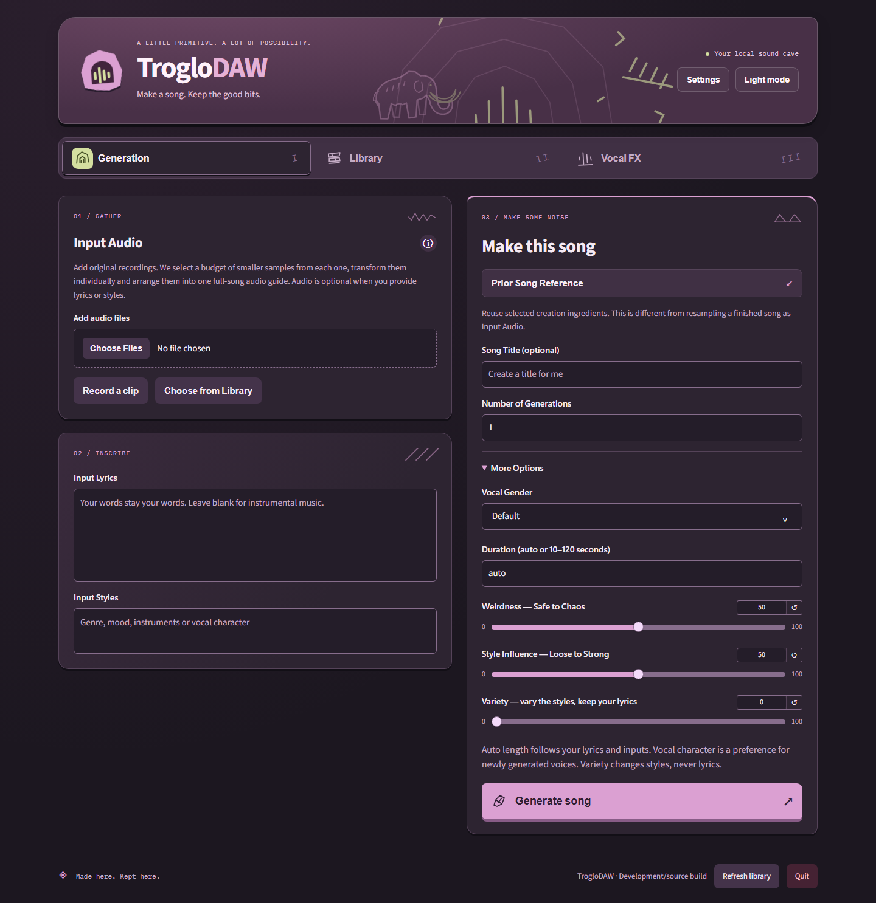
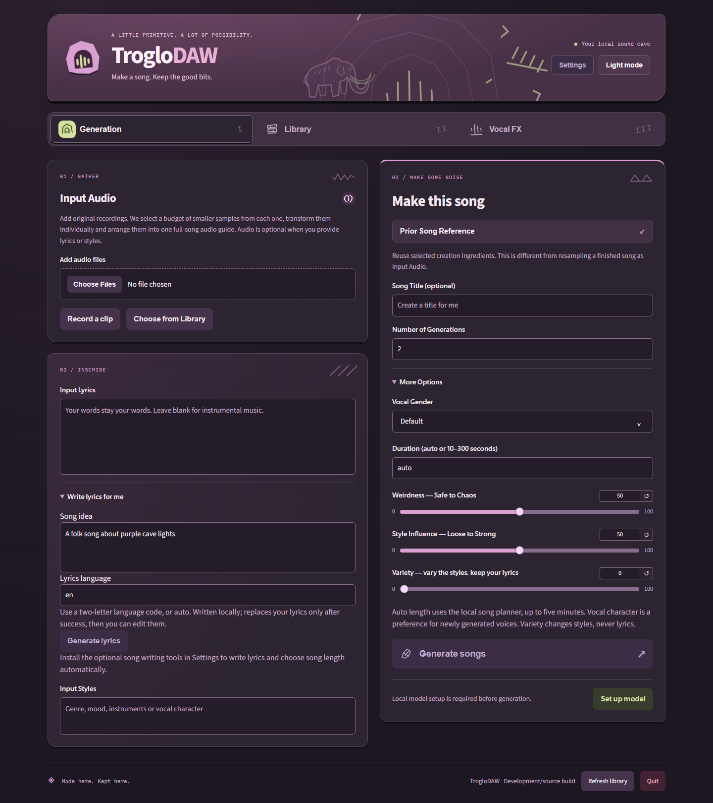

# Local lyrics and song length

In **Input Lyrics → Write lyrics for me**, enter a song idea and choose a language,
then generate a draft locally. Edit any words before creating songs. Manually entered
lyrics continue to work; leave the lyrics blank for an instrumental. Draft quality,
pronunciation and instruction following depend on the installed models.

The fresh default is **two songs**, generated sequentially with separate random seeds
and fresh inference processes. Change the count to one when preferred. Existing saved
draft counts remain unchanged. Duration defaults to **auto**: the local ACE planner
uses your styling and lyrics to suggest a length, bounded to 10–300 seconds. Enter an
explicit number to bypass length planning. A compatible installed planner can still
produce an internal musical metadata blueprint for text-driven/postmix rendering;
source-conditioned flows retain their recording structure. This never rewrites
lyrics/styles and has no planning controls. See [native comparisons](three-generation-workflows.md).
Original lyrics and styles remain unchanged;
recipes record the raw length suggestion, effective length and planner provenance.
The app does not silently substitute a fixed one-minute song when planning fails.

## Upgrade and retained model folders

Existing music models remain ready for explicit-duration generation. Automatic length
and lyric drafts need **Settings → Model storage → Install / verify song writing tools**.
This explicitly acquires about **4.91 GiB** of additional pinned assets: ACE's 1.7B
metadata planner and Qwen3's 0.6B lyric writer. Existing verified files are reused;
generation itself does not download anything. Select your retained model folder
first after a fresh reinstall. No catalog conversion or relocation is required.
Libraries, manually entered lyrics, saved counts and existing rendered songs remain
available. Model cleanup follows the same ownership rules as other installed assets.

The tools use the existing locked inference runtime. Models load sequentially, with
the planner process exiting before music generation loads its weights. Lyric writing
needs 2 GiB of free CUDA memory and 3 GiB of available RAM; automatic length planning
needs 4.5 GiB and 6 GiB respectively. Music generation still needs 5.5 GiB free CUDA
memory and 12 GiB available RAM. Decode-step events show activity; their unknown
total remains indeterminate instead of displaying an invented percentage.

## Target-hardware checks

On the RTX 3070 8 GiB, an explicit five-minute output completed at its full requested
duration in 89.2 seconds, with 57.4 seconds in model generation and 5.02 GiB peak CUDA
allocation. A two-song 120-second run produced distinct seeds and two full outputs.
These are observations, not ETA promises, and concurrent GPU use can affect timing.

Qwen's tested English cave/dinosaur and robot/bread ideas and a Spanish sailing idea
produced editable drafts in 6.6–10.0 seconds of decoding, at about 1.16 GiB peak CUDA
allocation. Their phrasing still needs editorial judgment. The app uses the author's
[documented non-thinking mode and sampling settings](https://huggingface.co/Qwen/Qwen3-0.6B).
ACE remains responsible for metadata planning, rather than replacing the user's
caption with its rewritten suggestion.

An end-to-end run with external socket connections blocked reused the installed
assets, wrote lyrics containing the requested purple-cave subject, planned 110 seconds
from those editable lyrics, and produced a full 110-second song. Writing took 25.1
seconds including fresh process/model startup; the complete planned music request
took 110.3 seconds. Planner peak was 3.51 GiB and lyric-writer peak was 1.16 GiB.
The planner uses supported CPU-offload initialization so BF16 conversion occurs
before GPU transfer. It stops after metadata instead of rewriting supplied lyrics.

## Actual interface before and after

These source-app captures use a temporary demonstration library, not personal audio.
Before: one-output default, 120-second limit and manual lyrics only.

After: editable local writing, a fresh two-output default and automatic/300-second
length controls. The local tools remain an explicit verified setup choice.

