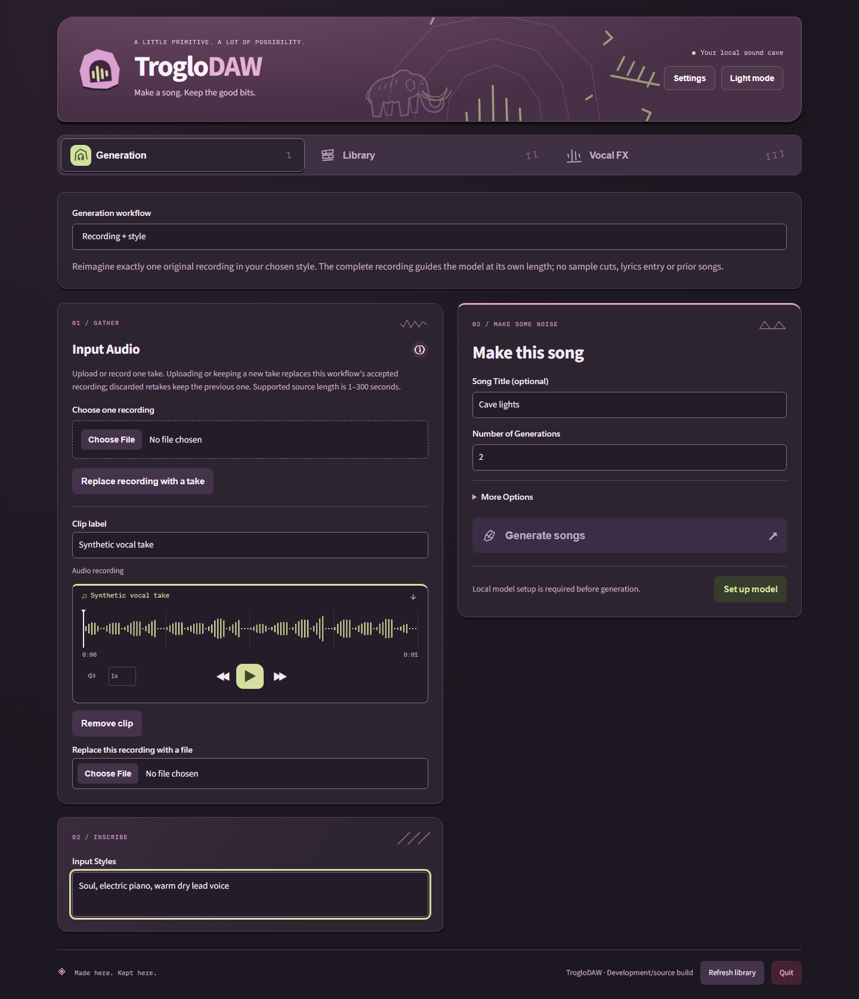
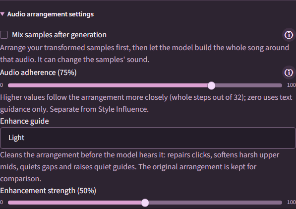

# TrogloDAW Song workflows

Expensive jobs remain visible above the workflows, including after navigation or
reload. The status distinguishes queue waiting from active elapsed time and,
when evidence supports them, stage/current-song/whole-request remaining ranges.
Diffusion steps, separation chunks, voice slots and sample/render work drive live
progress. Completed local runs continually improve comparable estimates; unknown
stages remain indeterminate. Cancel requests stay visible until acknowledged and
earlier completed songs survive a canceled batch. See [progress](progress.md).

TrogloDAW has three browser tabs: **Generation**, **Library** and **Vocal FX**. Settings
contains the initial model setup and separate library/model locations. After setup,
audio processing and storage work offline. See [model setup and measured limits](local-models.md).

**Quit** replaces the complete page with a stopped confirmation telling you to close
the browser window. If shutdown cannot be confirmed, the interface remains available
with an error so you can retry.

The product is designed for fully unfiltered local song creation, inspired by
frustration with tightening restrictions in hosted song tools such as Suno.
TrogloDAW adds no content moderation or word blacklists and passes supplied lyrics
to the local model unchanged. Supported lengths, input-size limits, memory guards
and the model's ability to deliver the requested words remain technical constraints.

## Generation

The **Generation workflow** selector offers **Generate a new song**, **Arrange
recordings over an existing song**, and **Recording + style**. Each preserves its
own draft across switching and reload. The backing workflow keeps one Library song,
uses separate sampled inputs, and works without a model. Model controls are hidden
but their drafts remain. See [WAV import and backing arrangements](backing-arrangements.md).

**Recording + style** accepts exactly one uploaded or microphone recording and
style instructions. Accepting another file/take replaces it; failed/discarded retakes
keep the previous recording. It uses the complete recording at its original length
(1–300 seconds), without sample cuts, guide enhancement or a second audio overlay.
Lyrics, lyric writing, Library priors and Prior Song Reference are unavailable.
Blank lyrics do not suppress source vocals. The validated Base latent source path
retains more vocal detail than ordinary Cover in the bounded comparison, but voices,
words and stylistic changes remain model-dependent. See [native validation](three-generation-workflows.md).

Current dark-mode examples use a temporary synthetic library with model setup
deferred. They demonstrate inputs and controls, not generated-audio quality:

Current recording and backing examples

### Generate a new song: sampled inputs

In **Generate a new song**, add multiple uploaded clips, microphone takes or
Library songs. The same per-clip controls apply to sampled inputs over a backing;
Recording + style accepts one intact recording instead. Each clip can be
previewed, labeled, removed, replaced or retaken independently. A new recording
requests microphone permission only when initiated. Stop, preview and keep a take,
or discard/record again. The old take stays selected until a replacement is kept.
Capture stops on stop/cancel/dialog exit/tab change/shutdown. Browser recording
requires localhost or another secure browser context. Permission, missing-device,
unsupported-format and empty-audio errors preserve existing inputs. Automated tests
use real MediaRecorder with a synthetic WebAudio stream; a physical microphone
check is optional after delivery.

Every selected input contributes to a full-song sample arrangement. A relative
energy analysis joins brief articulation gaps, retains audible phrase spans and
selects contrasting phrase, motif and accent cuts. A loud transient does not set
the threshold for the entire recording. Eligible 0.5–8-second inputs sometimes
contribute their complete clip as one sample when the song has enough space.
The `samples` budget caps distinct cut families (default eight, API maximum sixteen);
short inputs and short song durations can need fewer. Each cut has at most three
saved statement/response/fill variants, including bounded pitch, speed, filtering,
echo and gain differences. Statements retain phrase pitch/speed adjustments;
responses and fills evolve them. Finished Library songs receive automatic source-aware
hook/accent handling; accompanying recordings keep their own phrase material.

A shared detected tempo (or 90 BPM fallback) supports a section plan with quieter
openings/endings, fuller refrains, restrained bridges and intentional rests.
Placements use actual transformed lengths, avoid overlap and adjacent returns of
the same family when alternatives exist, and space family returns by at least eight
beats or twice the sample length. A transformed variant appears at most twice;
a family has two to six returns depending on song length, with complete clips
limited to two. Source selection, variants, sections and effective placement gains
are saved. The seed reproduces decisions; old recipes retain their saved layout.
[Synthetic before/after validation](sample-arrangements.md) shows the actual placements.
This is an inspectable heuristic arrangement, not a learned semantic composer or a
guarantee of musical harmony, sample identity or artistic quality. Key detection
and tempo estimation can be uncertain on speech or noisy recordings.

Phase-canceling stereo uses a recorded dominant-channel strategy for the guide;
original audio remains unchanged. Sample gain balancing is bounded to ±6 dB around
clip gain, and individual variants and the combined guide are attenuated if necessary
to retain a 0.8 peak ceiling. This protects against clipping without unlimited quiet
source/noise amplification. It does not make all recordings equally loud.

Fresh sampled drafts leave **Mix samples after generation** unchecked: the complete
sample arrangement guides the model. Checking it generates music independently,
then mixes transformed samples into it. Saved explicit choices remain unchanged.
The checkbox and Audio adherence have hover/focus/tap guidance. Without clips,
generation uses lyrics/styles directly and Input Audio settings are hidden.

Postmix gestures automatically match estimated generated-vocal loudness. Instrumental
requests use the generated song instead. With lyrics, the installed local HDemucs
separator measures a vocal reference without running speaker analysis; this adds
separation time after generation. Effectively silent stems fall back to song loudness.
Separation is an estimate and can contain instrumental bleed. Each transformed gesture
is measured using gated K-weighted loudness; gestures shorter than 400 ms repeat only
for measurement, preserving playback length. Automatic correction is bounded to
±30 dB. Very quiet/noisy sources can therefore still miss the target.

**Volume (dB)** is an offset from matched loudness: fresh clips default to 0,
negative values make samples quieter, positive values louder.
Explicit saved offsets remain unchanged. Recipes retain reference, measurements and
effective placement gains; replay needs no new separation. Final bus mastering can
change perceived balance. Existing songs replay their original gains.

Leave **Mix samples after generation** unchecked to use the complete arrangement WAV before
inference on a compatible model. The model produces the whole mix without a second
sample overlay or postmix loudness matching. **Audio adherence** (default 75%) maps
to source-conditioned diffusion steps out of 32; 0% disables that influence, 100% uses
it throughout. It is independent of Style Influence and can reinterpret samples,
voices or words. Unsupported conditioning falls back to postmix with an explanation.

**Enhance guide** (same settings panel, default **Light** at 50% strength) cleans the
arrangement just before the model hears it: click repair, gentle de-harshing,
quieter gaps and a bounded lift of quiet guides. The original arrangement is kept
beside the enhanced guide and both can be previewed in the result. **AI clean** is
shown but unavailable in this version. See [guide enhancement](guide-enhancement.md).

Original input copies, transformed sample WAVs, complete arrangement audio, model
output and gain-bearing placements remain separate inspectable assets. Conditioned
rerender uses the saved model mix; postmix rerender reconstructs the samples over
saved music. Older recipes retain their previous replay behavior. Selecting a
finished song as Input Audio immediately samples its rendered mix without a defaults
confirmation. Automatic policies distinguish single/multiple finished songs,
single/multiple recordings and all mixed combinations. Finished mixes favor
restrained onset-based hooks/accents and octave-based variations; recordings retain
phrases. Manual clip settings, lyrics and styles stay unchanged. Requested/effective
budgets, source roles and the policy version remain in the saved recipe. See
[source-aware sampling](source-aware-sampling.md) for the comparison and limits.

Lyrics/styles work without audio input. Expand **Write lyrics for me** to draft editable lyrics locally, or type your own and leave the field blank for an instrumental. See [local song planning](song-planning.md). The exact supplied lyrics reach the local
model. Blank titles derive from up to six lyric/style words. **Number of
Generations** defaults to two for fresh drafts, supports 1–32, and runs independent seeds
sequentially. Each song is separately cataloged; earlier successes remain if
another output fails or the request is canceled. Completed outputs are visible
while later outputs run. Model quality can repeat material or pronounce lyrics
imperfectly; this is documented rather than hidden by rewriting lyrics.

For sampled model generation, **More Options** is initially collapsed and contains:

| Control         | Local mapping                                                                                                                                                                                                |
| --------------- | ------------------------------------------------------------------------------------------------------------------------------------------------------------------------------------------------------------ |
| Vocal Gender    | Unset/Male/Female caption guidance for newly generated voices; a preference, not guaranteed classification or an effect on source recordings                                                                 |
| Duration        | Auto uses the optional local model planner before arranging samples and bounds its suggested length to 10–300 seconds; explicit lengths must be within that range |
| Weirdness       | 0–100 maps to schedule shift 1–5 with the supported ODE sampler throughout; independent of style guidance                                                                                                 |
| Style Influence | 0–100 maps to Base-family classifier-free guidance 1–15                                                                                                                                                      |
| Variety         | Zero retains styles exactly; higher values append one to three seeded performance directions within the requested mood, style, rhythm, delivery, sound sources and form; lyrics stay unchanged |

Recording + style shows only Weirdness and Style Influence in More Options; it
uses source length and source vocals. The backing choice hides model options.

These are validated local parameter mappings, not a claim to implement Suno's
undisclosed algorithms. Original/effective styles, options, automatic-duration
reasoning, source IDs, transformations, placements, seed and exact model identity
are retained per output. Saved generated WAVs are the reproducibility source;
seeds alone do not promise identical future inference.

**Prior Song Reference** shows individually selectable saved ingredients and their
values: original audio, lyrics, styles, title, controls and sample arrangement.
Only checked fields replace the draft. Unavailable legacy fields remain labeled.
Legacy procedural songs expose actual stored style/title; older mixes expose their
input voice if still available. Tab navigation and browser reload preserve the
Generation draft. Library recipe inspection includes original input, sample and
generated-audio players; missing assets are explicit.

## Library and Vocal FX

Library defaults to 20 songs per page, with 10/20/50 choices. Search and folder
filters apply to the complete library. Press **Select songs** to reveal checkboxes;
**Select page** selects only the current page. Changing filters, page or page size
clears selection. **Move selected…** organizes multiple songs into existing or
new folders; **Delete selected…** confirms their names and reports partial failures
without losing failed selections. See [bulk actions and recovery](library-bulk-actions.md).

Search, play and rename songs, create folders and move songs without changing IDs
or asset references. Song actions open Generation/Input Audio, selective recipe
reuse or Vocal FX directly. Existing catalogs and legacy CLI recipes stay usable.
Settings opens a Windows folder browser. If the current folder contains data,
choose to move it, use the selected folder without moving, or cancel. Moves use a
verified staging copy before switching locations and remove only unchanged managed
originals. Shared, changed and unrelated files remain; populated destinations are
not overwritten. Existing song playback links follow a successful library move.

Vocal FX looks up source-content/model/runtime-version caches and extracts missing
vocals automatically in a background job. Candidate voices are uncertain, with
solo previews and timeline correction/grouping. **Apply effects to** defaults to
**All vocals**, including uncertain segments and voices that start before the first
listed candidate. Solo all vocals plays the full vocal stem. Select a candidate to
edit that group independently; differing values show **Mixed** when returning to All
vocals. Changing one control applies only that parameter to every target group,
preserving other group differences. The effects are the existing pitch,
stretch, gain, low/high-cut EQ, compression, chorus, robot, echo/delay, reverb,
trim and normalization controls; details are progressively disclosed.

Each group occupies fixed original timeline segments. Trim retains its starting
offset; stretching is padded/cropped to the slot; tails are clipped at slot/song
end. Final sample rate/count/duration match the original. The edited vocals replace
the extracted vocals over the residual accompaniment, avoiding double vocals.
First save creates a distinct `_FX` song with lineage. Later saves explicitly offer
**Update this FX version** or **Save a new FX version**. Every edit starts from
cached unprocessed source stems, avoiding repeated baking of earlier effects.
Changing source audio or relevant processor versions invalidates cached stems.
Source/cache/edited assets and recipes remain with the complete portable library.

Every shared audio player shows a playhead over its waveform, including input clips,
recording previews, Library assets, vocal solos and remixes. It follows playback,
seek and skip position, stays visible while paused and resets for replacement audio.
