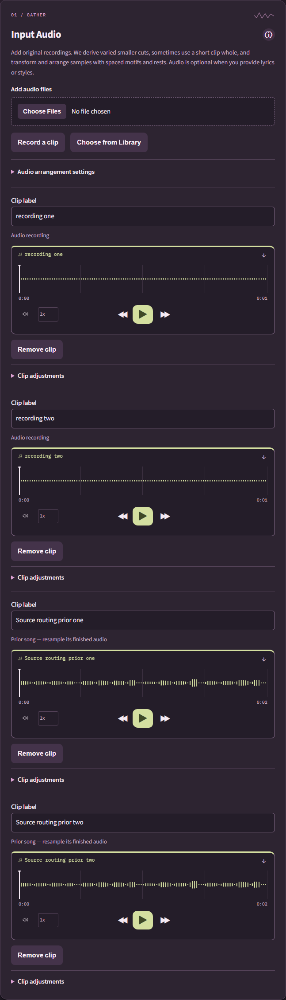

# Source-aware sampling

Selecting **Use as Input Audio** in Library adds the song directly. There is no
optimized-defaults prompt. Lyrics, styles and manual clip adjustments stay as they
are; the automatic planner records its decisions separately.

## Source roles

The server resolves source IDs and saved-source lineage. A finished Library song
is a completed mix, while uploads and microphone takes remain recordings. A
filename cannot change this classification. Each source is handled independently.
Reuploaded songs without Library lineage remain recordings; treating an audio file
as a Library song is a separate import workflow.

| Input collection | Automatic handling |
| --- | --- |
| One prior song | Up to six hook/accent families; restrained density and three family appearances maximum. |
| Multiple prior songs | Up to four families per song; shared timeline and restrained returns. |
| One recording | Existing phrase/motif/short-whole-clip selection, within its requested cap. |
| Multiple recordings | Up to four families each, phrase/call-response roles and lower shared density. |
| One prior + one recording | Up to two prior accents; recording phrases receive a larger timeline budget. |
| One prior + multiple recordings | Two prior accents maximum, with independent recording response material. |
| Multiple priors + one recording | Two accent families per prior; the recording keeps its phrase role. |
| Multiple priors + multiple recordings | Independent accents/responses, weighted budgets and shared bounded layout. |

These are upper bounds; actual budgets shrink for available audible material, song
duration and the user's sample cap. Finished mixes use measured spectral-flux
onsets and smaller tempo-relative cuts. Tempo is trusted only above the analyzer's
2.0 confidence threshold; otherwise the recipe identifies a fallback grid.
Confident prior-song tempo takes precedence over recording estimates.

Finished-mix pitch variants add octaves rather than arbitrary scale intervals;
an octave outside the supported range keeps the requested register. Their speed
variation is restrained. Explicit pitch/speed/volume adjustments remain effective
and are saved. Recording phrase transformations retain the existing behavior.
Full songs are never indiscriminately overlaid as complete input recordings.

The arrangement retains original sources, derived cuts, transformed variants,
gain-bearing placements and versioned routing (`source-roles-v1`, planner
`phrase-motifs-v3`). Every selected source contributes. Both source conditioning
and postmix consume that same arrangement through their existing distinct paths.
Saved songs replay stored audio/placements; old preset choices are accepted as
historical metadata and are not demanded or reapplied to new requests.

## Investigation and measured comparison

Local Windows observations, RTX 3070 8 GB/display active and approximately 32 GB
RAM, using synthetic sources only. The policy itself runs on CPU and allocates no
GPU model. Forty-eight combinations were compared: eight collections, two seeds
and three approaches. Each source used the same 12-second harmonic/percussive
fixture to isolate policy differences, with a 120-second target. Recording-specific
phrase/quiet/stereo fixtures are covered separately by the existing arrangement
tests and mixed-source recipe/replay test.

The fixed-preset comparison applies the former one-second/+2-semitone/1.1x prior
defaults. Conditional-only uses role budgets without onset analysis. Analyzed
routing adds measured anchors. Seed 42 results:

| Collection | Fixed preset cuts / placements | Analyzed cuts / placements | Occupied timeline, fixed → analyzed |
| --- | --- | --- | --- |
| One prior | 7 / 28 | 6 / 18 | 18.7% → 13.6% |
| One recording | 7 / 16 | 7 / 16 | 35.0% → 35.0% |
| Multiple priors | 14 / 46 | 8 / 24 | 29.8% → 17.2% |
| Multiple recordings | 14 / 18 | 8 / 17 | 44.8% → 30.7% |
| One prior + one recording | 14 / 27 | 9 / 15 | 43.4% → 32.6% |
| One prior + multiple recordings | 21 / 26 | 10 / 19 | 49.2% → 29.6% |
| Multiple priors + one recording | 21 / 37 | 11 / 15 | 46.0% → 30.9% |
| Multiple priors + multiple recordings | 26 / 35 | 12 / 20 | 48.8% → 29.1% |

Analyzed planning took roughly 16–94 ms in those seed-42 observations, excluding
decode, the existing vocal/tempo analyzer, DSP, asset writes and music inference.
All selected prior families in this fixture were onset anchored. These figures
show actual routing/placement changes, not subjective listening scores, genre
accuracy, speaker recognition or calibrated user-facing ETAs. Raw private evidence
is retained on D:; no personal recordings or model caches are committed.

Free-text prompting alone cannot establish authoritative waveform cut positions.
The automatic layer therefore uses measured audio plus trusted source roles.
Eager stem extraction was considered but is not required: WRK-7's separate native
investigation measured additional GPU/CPU work, leakage and substantial storage.
Its observed four-track 120-second extraction took 4.31 s on GPU or 21.83 s on CPU,
excluding Python/Torch import and singer analysis, and four float32 tracks added
169.34 MB. Those are prior one-run observations, not new integrated benchmarks.
On-demand stems remain a future independent capability.

## Context and complementary model parts

[Remiqora's pinned arranger utility](https://github.com/inikolax/remiqora/blob/b4d4afe6494f5aa9a259c63a37f53788c3d67501/frontend/src/utils/aiParts.ts)
renders timed lane context and measures context/output correlation. Its
[part panel](https://github.com/inikolax/remiqora/blob/b4d4afe6494f5aa9a259c63a37f53788c3d67501/frontend/src/components/editor/AiPartPanel.vue)
uses model task capabilities and region seam fades. These are useful reference
mechanisms; no source code was copied. TrogloDAW already renders the complete
transformed guide with saved timing/gains and fades. Conditioned generation saves
the model's whole mix; postmix retains the exact transformed sample layer, avoiding
a second overlay in the conditioned path.

Complementary LEGO parts and whole-mix Cover/Repaint have different contracts.
The pinned ACE runtime must be tested before enabling a new task; semantic audio
codes can supersede source audio, and an output correlated with context may simply
be a copy. Correlation is a diagnostic, not a universal quality gate. The separate
WRK-27 work owns these capability/blueprint changes. This implementation does not
silently switch tasks, assume genre quality or add a DAW editor. WRK-25's fixed
backing workflow keeps the selected song as the backing audio.

## Limits and validation

Source handling is a heuristic arranger. It does not transcribe meaning, detect
singers reliably, separate polyphonic instruments, guarantee harmony or prove
that a result sounds good. Noise, ambient sound, irregular rhythm and ambiguous
key/tempo can require different source material or manual adjustments. A Library
vocal-only song remains a prior by lineage without claiming it contains instruments.
No blind listening or ground-truth separation-quality score is claimed.

Tests cover all eight source matrices, misleading client/filename labels, old
preset acceptance, quiet-source mixing, octave boundaries, source preservation,
seed reproducibility, bounded returns/rests and recipe replay after relocation.
Real-service browser checks cover direct addition, retained lyrics/styles/counts,
reload and desktop/narrow layouts in both themes.

## UI evidence

Before: selecting a Library song interrupted the workflow with fixed defaults.

After: two recordings and two prior songs coexist directly in Input Audio; manual
controls remain collapsible and no extra source-policy settings are exposed.

[Narrow light-mode view](assets/source-routing-after-light-390.png) was also
inspected, alongside the narrow dark and desktop light screenshots from the
real-service regression. No clipping/overlap or horizontal overflow was observed
in this flow. Only synthetic fixtures are shown.
