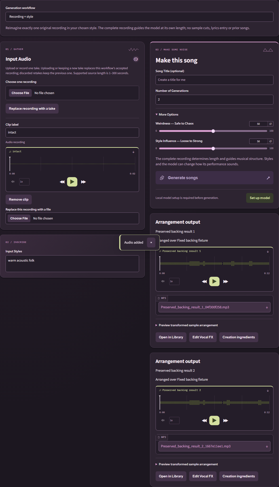
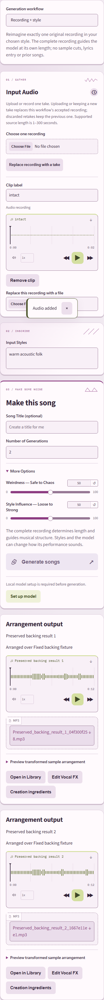
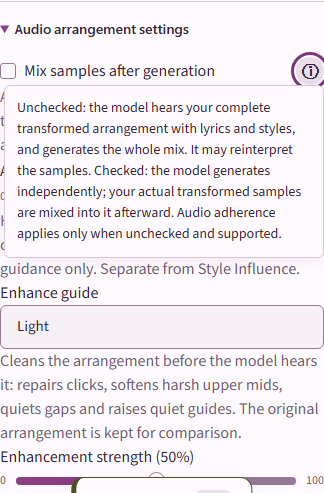

# Three generation workflows and native validation

## Contracts

| Choice | Inputs | Musical guidance | Output |
| --- | --- | --- | --- |
| Generate a new song | Recordings/Library priors, optional lyrics/styles | Full sample arrangement by default; internal source-aware phrase/section plan | Model-generated whole mix |
| Arrange recordings over an existing song | One Library backing plus separate recordings | Measured backing tempo/sections and CPU arrangement plan | Preserved backing with transformed recordings |
| Recording + style | Exactly one upload/microphone recording and styles | Complete original recording through validated latent source conditioning | Model-generated whole mix at source length |

The first choice retains an optional **Mix samples after generation** checkbox:
checked means independent model music followed by sample overlay. Unchecked means
the model hears the complete arrangement, with no second overlay. Hover, keyboard
focus and tap explain the distinction and Audio adherence. Explicit saved choices
and historical recipe replay remain unchanged. The three drafts survive switching,
reload and selective recipe reuse. Direct recording accepts replacement/retakes
without dropping the previous accepted take on error or discard.

Direct recording supports 1–300 seconds. The complete decoded source is saved and
passed unchanged: no sample selection, pitch/stretch/gain controls, guide enhancement,
lyric writing or prior/reference input. Source length controls the result. The pinned
decoder pads very short material to 5.12 seconds; the adapter removes only that
generated tail. It never cuts the input recording or adds it again after inference.
Blank lyrics do not request an instrumental. Source/voice/style fidelity remains
model-dependent; this is not a voice-cloning or exact-word guarantee.

Direct length uses the accepted waveform's exact sample count. To preserve a
partial final decoder frame, the adapter adds less than 40 ms of silence inside
the encoder and removes only the excess generated tail. This avoids false
incomplete-timeline failures on fractional-second uploads without rewriting the
recording or padding genuinely short model output. See [retry guidance](generation-recovery.md#recording--style-reports-an-incomplete-timeline).

## Internal planning

Base advertises a validated `musical_metadata` planning input. With the existing
optional, verified ACE 5Hz LM 1.7B installed, text-driven and explicit postmix outputs
receive a local tempo/key/meter blueprint. Each blueprint runs in its own process
before music weights load. It passes exact lyrics/styles and effective duration,
disables text/language rewriting, validates metadata and saves a relative managed
JSON artifact. Literal numeric BPM, named major/minor keys and supported meters in
styles take precedence. Only validated musical fields reach the renderer; suggested
text, language and duration cannot overwrite the request.

Conditioned flows use their source structure and bypass competing text blueprints.
Fixed backing retains its CPU plan without invoking music-model planning. Unsupported
models and absent optional assets keep the supported generation path. Planner failure
reports original-input fallback; cancellation stops the current output while retaining
completed songs. Replay uses saved model/backing audio and placements without another
planner. There are no new planner controls, downloads or remote services. WRK-24's
separate enrichment work can remain off: this layer never rewrites prompts.

## Native comparison, 13 October 2026

Tests used pinned ACE runtime `ca1e85fe9430179831e6bc6be790c332190a3866`, Base weights,
installed 1.7B planner, embedded Windows Python 3.12.10, torch 2.7.1+cu128 and an RTX
3070 (8 GiB). GPU stages ran sequentially in fresh processes with CPU/DiT offload,
BF16, seed 42, CFG 8 and 32 ODE steps. Socket connects were blocked, including implicit
downloads. Fixtures were invented/generated; no personal recordings were used.

| Current production path | Audio length | Wall time | Model computation | Peak process RSS | Peak CUDA allocation |
| --- | --- | --- | --- | --- | --- |
| Unplanned text baseline | 10 s | 31.05 s | 14.20 s | 10.93 GiB | 4.52 GiB |
| Metadata blueprint | — | 44.05 s | 5.06 s | 11.38 GiB | 3.47 GiB |
| Render that blueprint | 10 s | 39.50 s | 24.22 s | 10.92 GiB | 4.52 GiB |
| Intact recording | 1 s | 34.72 s | 19.72 s | 10.96 GiB | 4.68 GiB |
| Intact recording | 7 s | 36.48 s | 18.11 s | 10.95 GiB | 4.68 GiB |
| Intact recording | 10 s | 32.73 s | 15.59 s | 11.02 GiB | 4.68 GiB |

Wall time includes imports/loading and varies with caches and concurrent CPU/browser
checks; these are individual observations, not latency promises. CUDA allocation does
not include all driver/display use. Existing driver-wide memory guards remain active.
All outputs were finite at 48 kHz, peaked at or below 0.8913 before app mastering,
and retained the tested lengths. The one-second result removed 197,760 generated
padding samples. Five-minute source length is the supported bound, not a new native
five-minute performance benchmark; see the existing [model limits](local-models.md).

The baseline used invented words “Purple cave lights shine. These words are mine.”
and acoustic folk styling. Local Whisper tiny.en recognized those words in baseline
and metadata-planned renders. With no supplied lyrics and soul/electric-piano styling,
ordinary Cover did not recover the phrase, while Cover-nofsq recognized “Purple
cave-like shine, these words are mine.” The selected direct path preserves full latent
source information rather than quantizing it into coarse semantic codes.

The 1.7B planner also produced 50 valid semantic codes for ten seconds. Full-strength
and half-strength semantic-code renders changed recognized words substantially, so
they are rejected for automatic use. Valid code syntax alone does not establish useful
music or lyric fidelity. The metadata path retained the phrase in this comparison.
ASR is an imperfect proxy; there is no human listening score, universal genre-quality
claim, or guarantee for multilingual speech, noise or overlapping voices.
The diagnostic used OpenAI Whisper 20250625 with the existing tiny.en weights,
temperature zero, English, CPU and no previous-text conditioning. Those development
tools are not runtime dependencies or additional app downloads.

## Source/complementary reference

[Remiqora](https://github.com/inikolax/remiqora/tree/b4d4afe6494f5aa9a259c63a37f53788c3d67501) at
`b4d4afe6494f5aa9a259c63a37f53788c3d67501` (MIT) demonstrates rendering the full audible
context and choosing complementary LEGO parts versus replacement Cover/Repaint.
This informed the intact source contract; no source was copied. Its batch/step counts,
level normalization and copying thresholds were not adopted as quality guarantees.

A pinned LEGO drums experiment with the ten-second vocal/music context, explicit
`Generate the DRUMS track based on the audio context:` instruction and gentle percussion
caption completed offline: 43.20 seconds wall, 23.59 seconds model computation,
10.96 GiB peak RSS and 4.68 GiB CUDA. It is a research candidate, not an automatically
qualified replacement for full-song generation. Despite a drums-only instruction,
ASR recovered the source phrase; whole-mix zero-lag correlation was 0.3507. This is
evidence of context leakage/copying risk, not a separated drums lane or quality score.
Adding a source-conditioned complementary
lane would change the independent-postmix checkbox's meaning and needs broader musical
and exclusion/fidelity evaluation. No extra public task or configuration is introduced.

Primary runtime evidence:
[direct-task LM bypass and metadata API](https://github.com/ace-step/ACE-Step-1.5/blob/ca1e85fe9430179831e6bc6be790c332190a3866/acestep/inference.py),
[two-phase local music planner](https://github.com/ace-step/ACE-Step-1.5/blob/ca1e85fe9430179831e6bc6be790c332190a3866/acestep/llm_inference.py),
and [task instructions](https://github.com/ace-step/ACE-Step-1.5/blob/ca1e85fe9430179831e6bc6be790c332190a3866/acestep/constants.py).

## Interface review

Compiled real-service tests cover independent drafts/reload, single-source replacement,
failed uploads retaining the old take, conditioning defaults and saved postmix choices,
keyboard/tap/hover tooltips, portable replay and unchanged backing generation. Review
included desktop 1440px/narrow 390px in both themes. A discovered long failed-upload
message now wraps within the processing card instead of causing horizontal overflow.
Selective recipe workflow reuse also saves the outgoing draft before restoring another.
Physical microphone quality and artistic output remain outside automated assertions.

