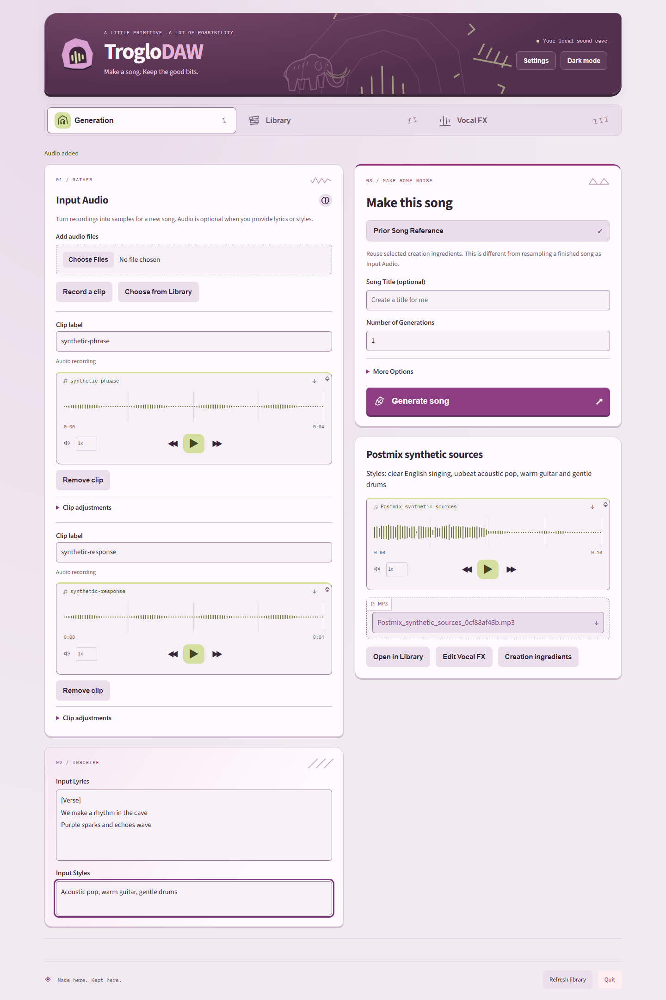
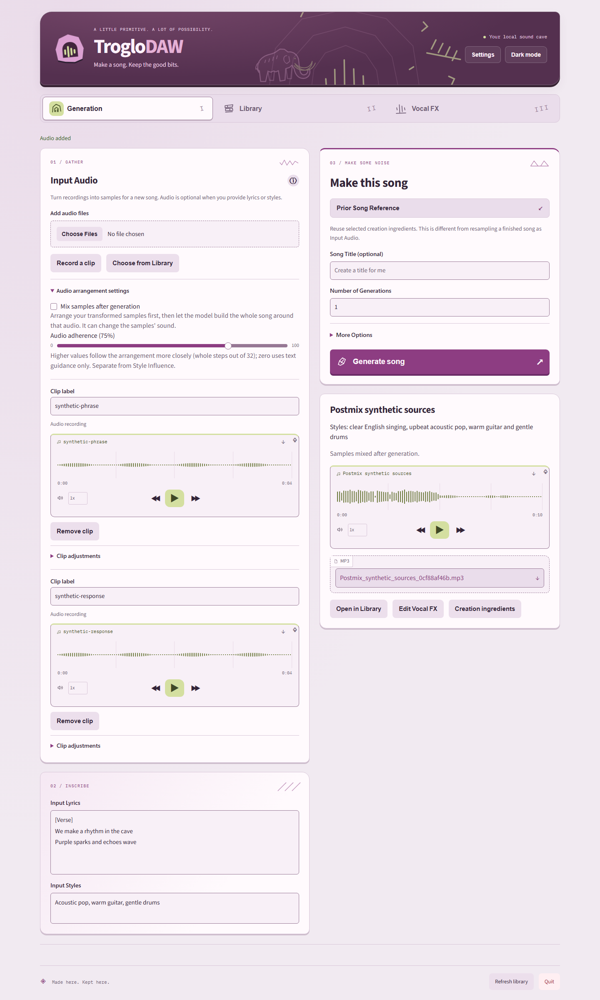
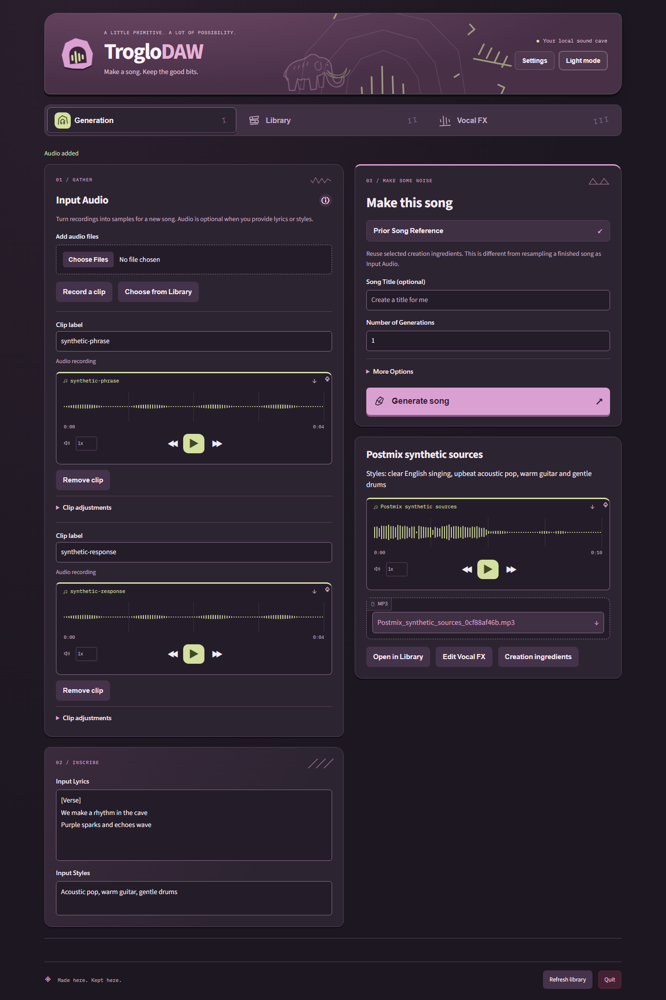
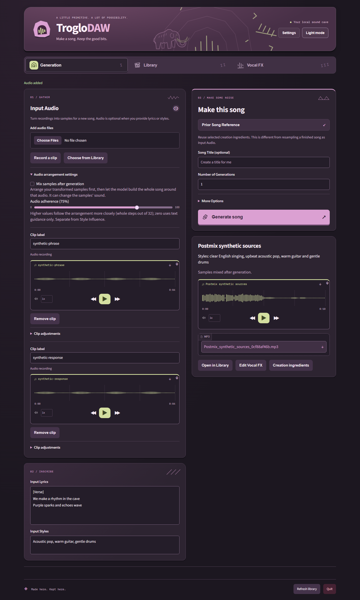
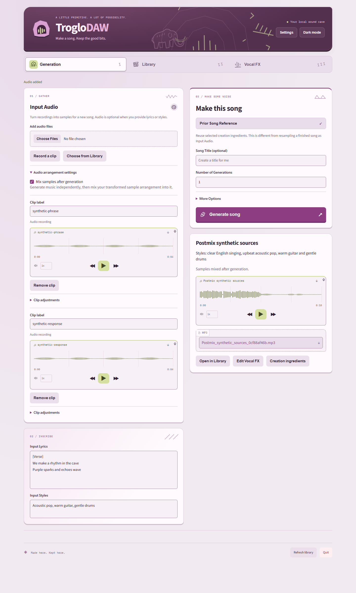
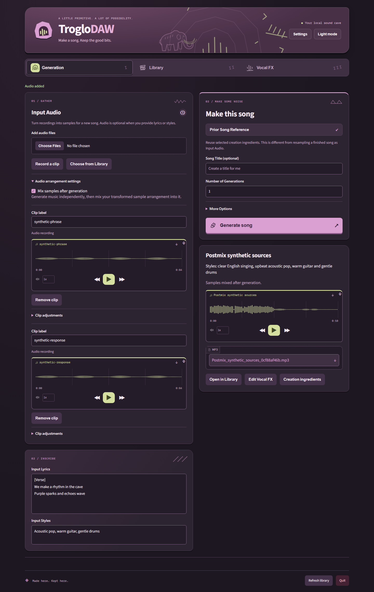
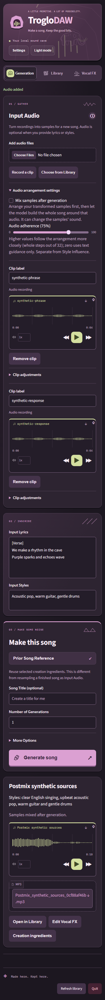
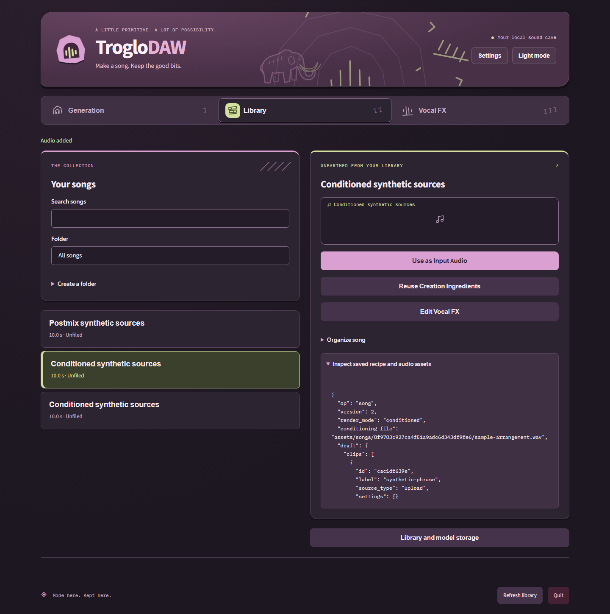

# Input Audio before and after

These captures use the real local FastAPI service and two synthetic four-second
recordings. **Before** uses the final branding PR's compiled interface; **after**
uses the audio correction with expanded settings inside Input Audio. The visible
previous result is an actual postmix generation from those inputs. The separate
conditioned-assets capture shows an actual Base-conditioned song's saved assets.
No personal audio or inference caches are included in this gallery.

| Mode | Before | After |
| --- | --- | --- |
| Light |  |  |
| Dark |  |  |

| Additional state | Capture |
| --- | --- |
| Explicit post-generation mixing, light |  |
| Explicit post-generation mixing, dark |  |
| Narrow conditioning controls |  |
| Real conditioned result and saved assets |  |

The source and installed browser suites validate applicable controls, persistence,
mode selection, recording workflows and both themes. Hardware results and the
checkpoint compatibility repair are described in [model validation](../../local-models.md).
