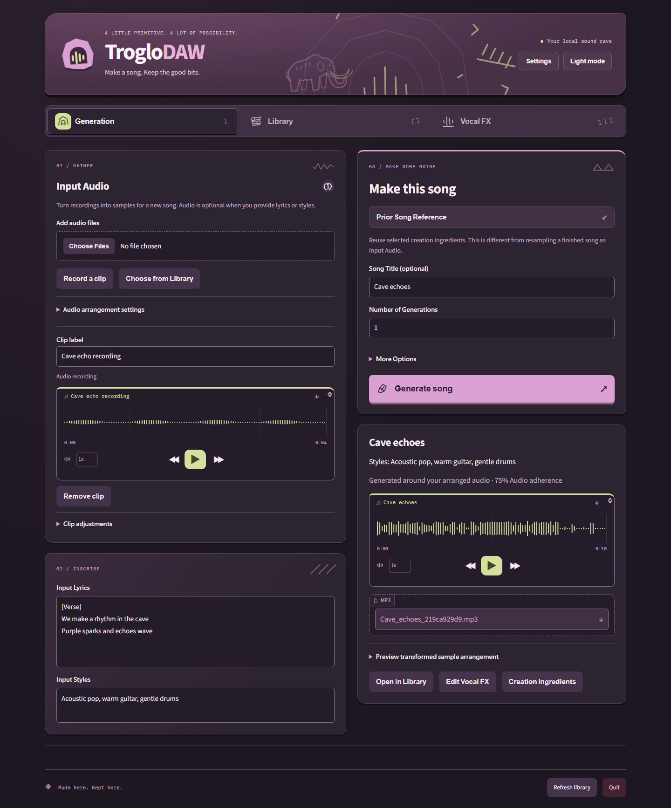
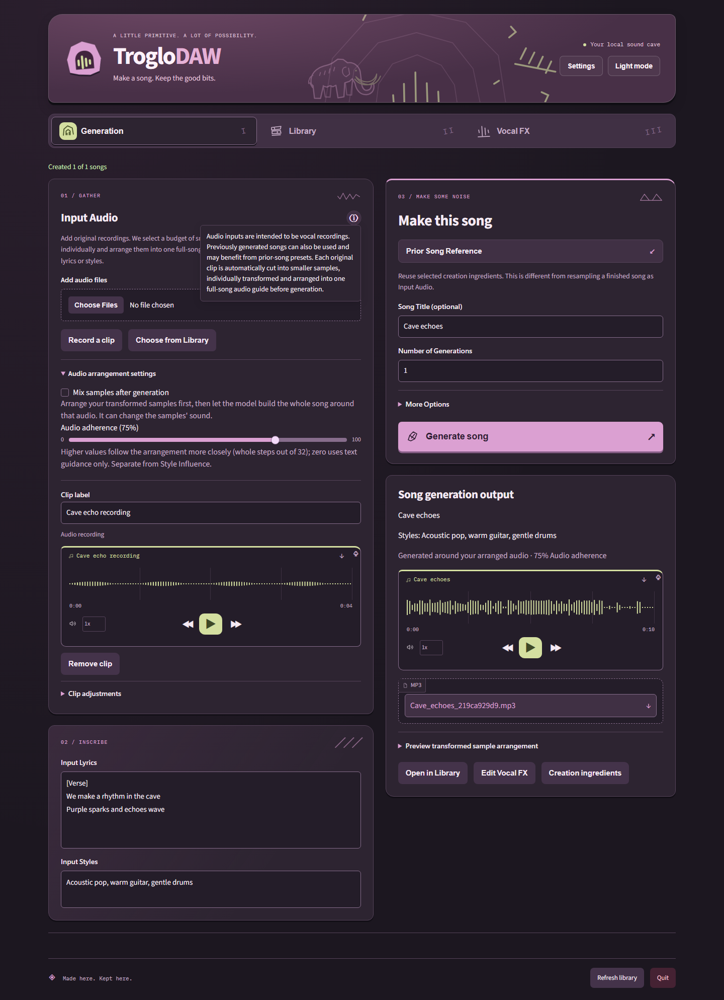

# Product identity and overview evidence

The same synthetic recording, lyrics/styles and real ACE-Step Base generation
are shown before and after the complete current-name rename. **Cave echoes** is
a real ten-second conditioned model output, not a mocked result. Its Vocal FX
screenshot uses live local separation/analysis; voice grouping remains uncertain.
No personal audio is committed.

| Before | After |
| --- | --- |
|  |  |

The before image uses the previously compiled PR #5 UI against the same live
service. A capture-only request-header translation connects that older UI to the
renamed service; no such compatibility path ships in the app. The after image
opens Audio arrangement settings and the accessible input tooltip to show the
clarification. Controls and automatic sample management retain their layout.

The repository overview uses dark-only screenshots from the actual running app:

- [Generation with completed song output](../../assets/generation-dark.png)
- [Library with loaded playback](../../assets/library-dark.png)
- [Vocal FX with live prepared stems/groups](../../assets/vocal-fx-dark.png)

The banner, mammoth and workflow glyphs reuse vector paths from the app itself.
Synthetic demo titles are normal song names rather than processing terminology.
The local run produced no browser errors. Native install/upgrade/uninstall tests
use the renamed payload, CLI, registry and shortcuts and preserve model/library
preferences and unrelated entries.
