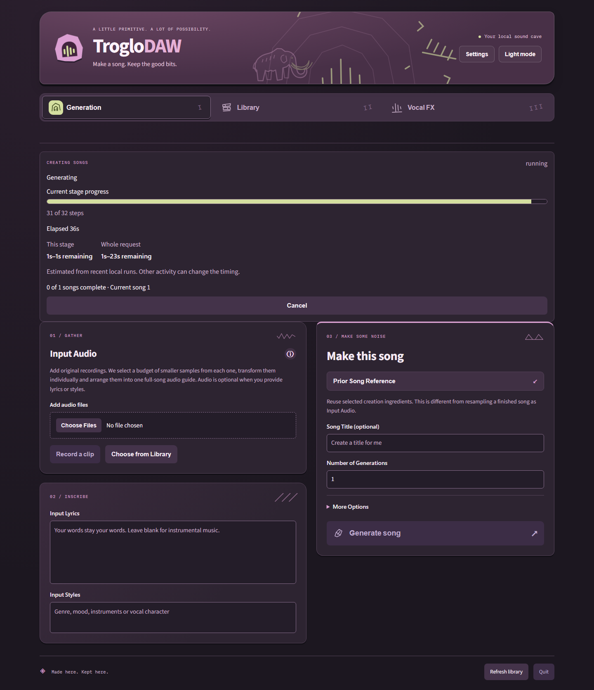
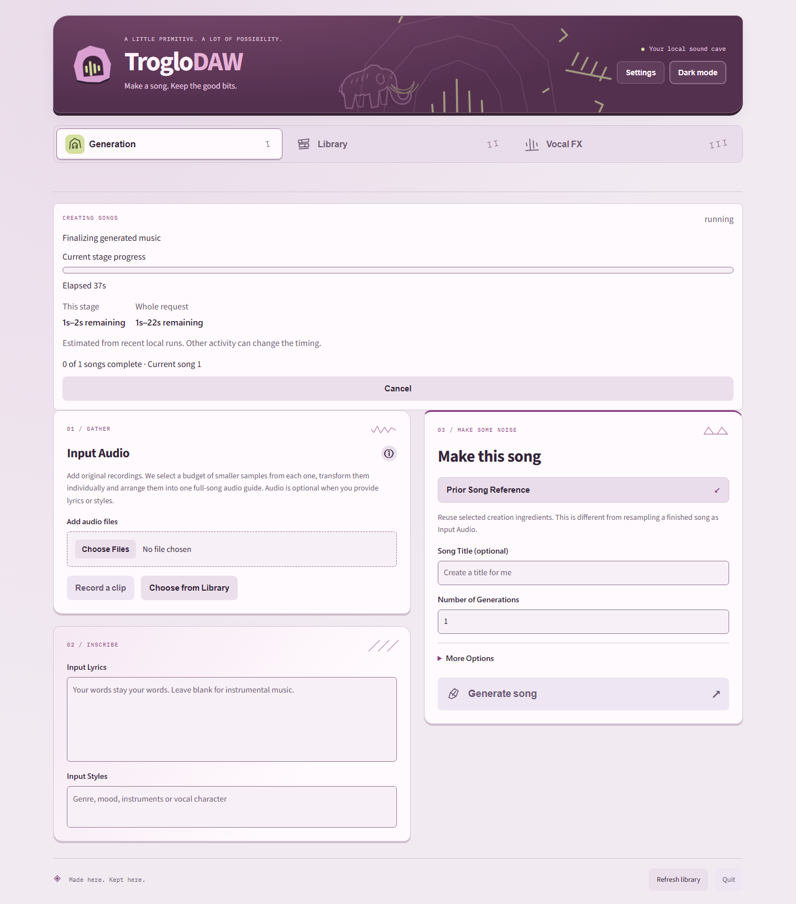

# Measured job progress

Actual Base inference against a temporary synthetic library, 1440 × 1100 browser
viewport. The status persists across a browser reload and navigation between
Generation and Library; screenshots contain real active backend job snapshots.
The fields separate completed diffusion steps, elapsed time, stage and full-request
estimates. Multi-output jobs also show current/completed/total song counts.

| Before | After |
| --- | --- |
|  |  |

The previous screenshot is historical rename evidence; see [prediction measurements
and limitations](../../progress.md). Synthetic fixtures and generated test outputs
are kept outside the repository. No personal recordings or model files are committed.
