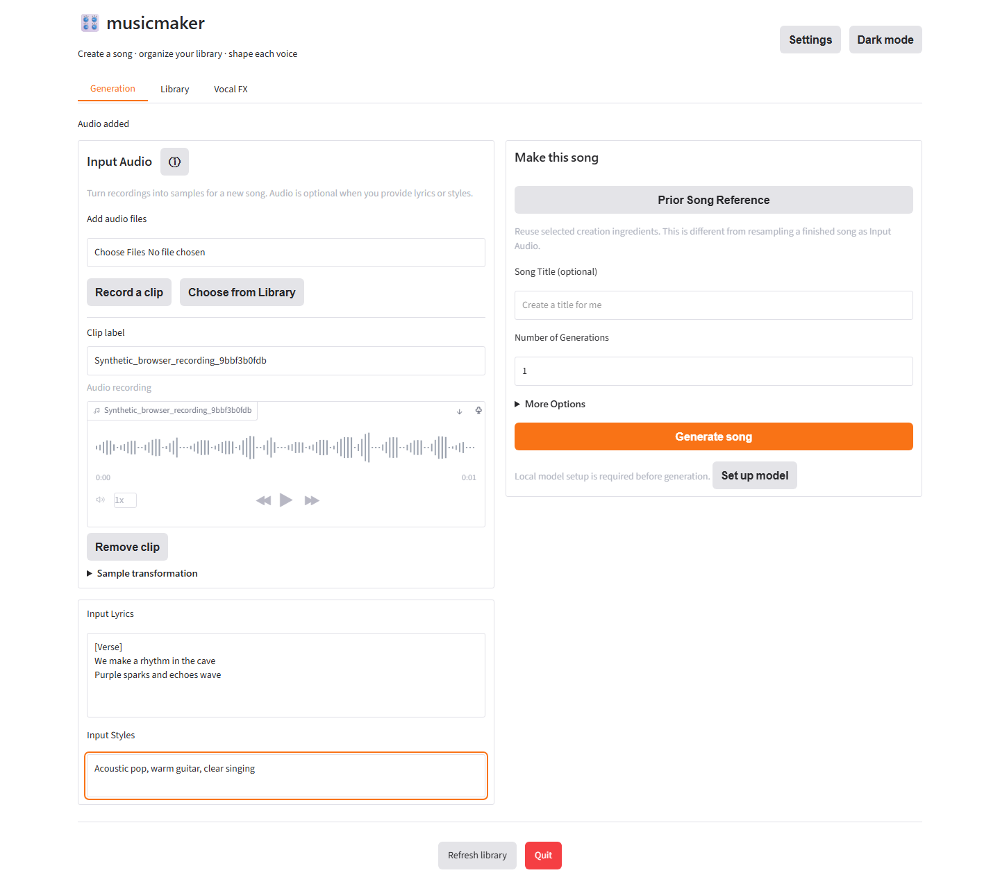
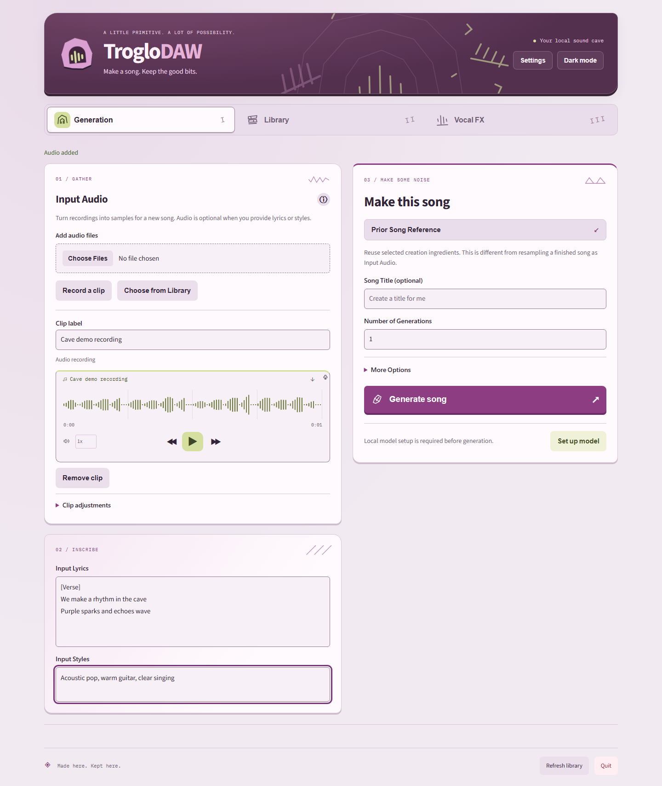
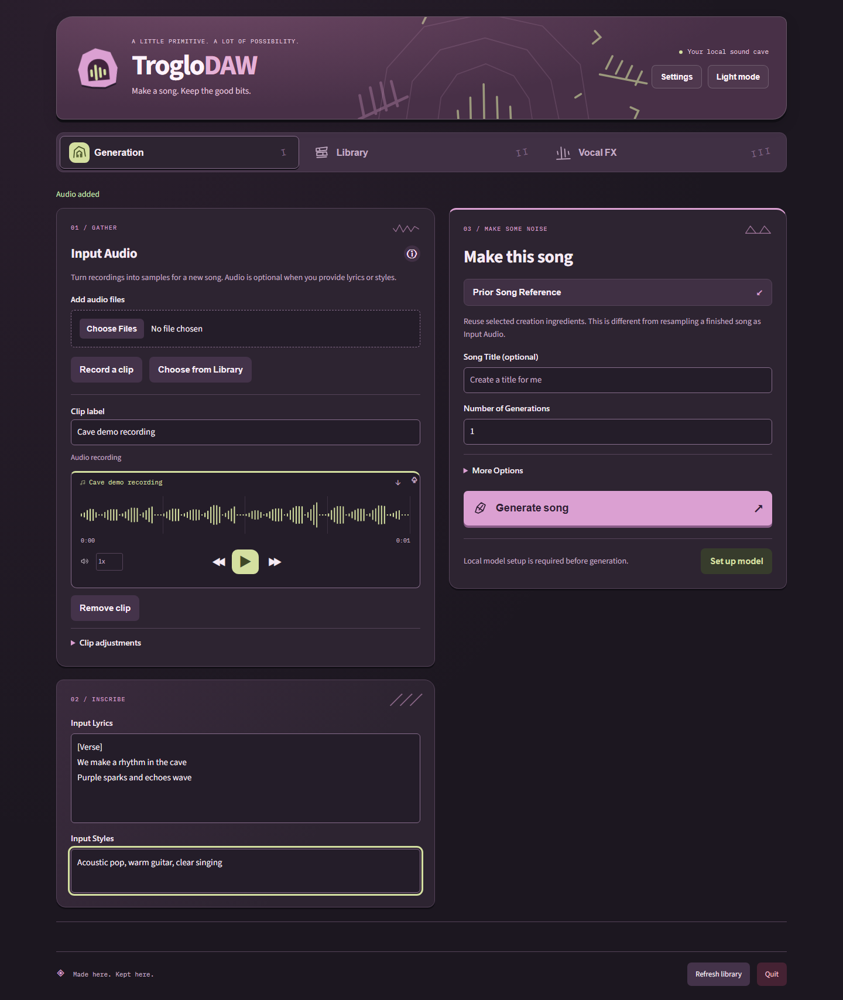
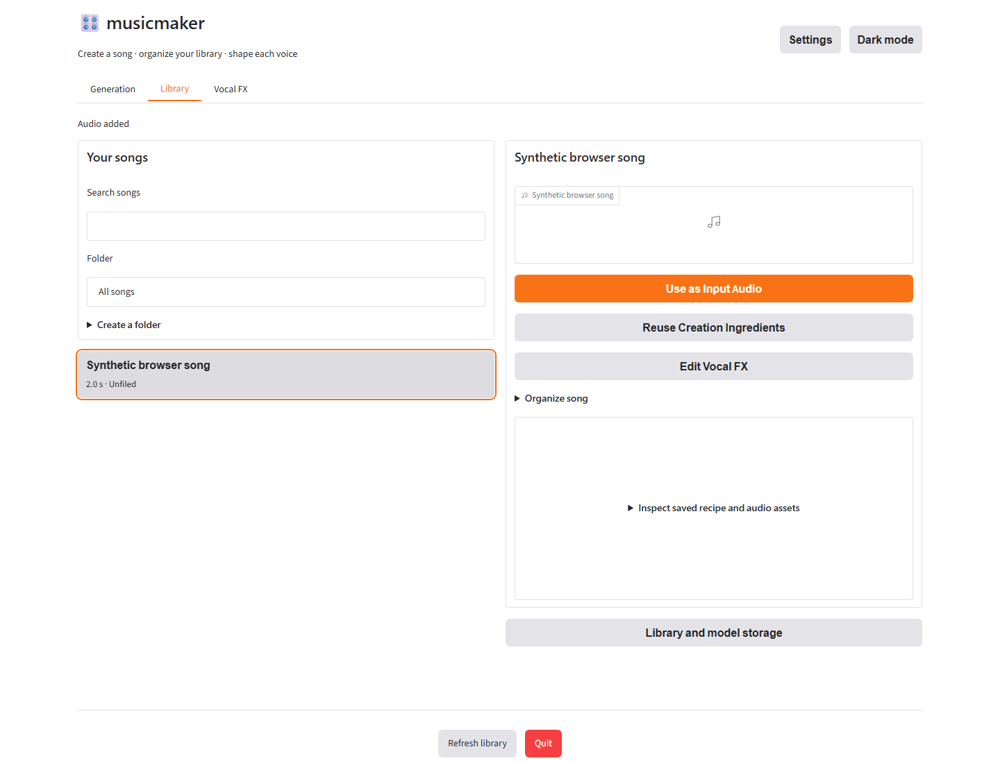
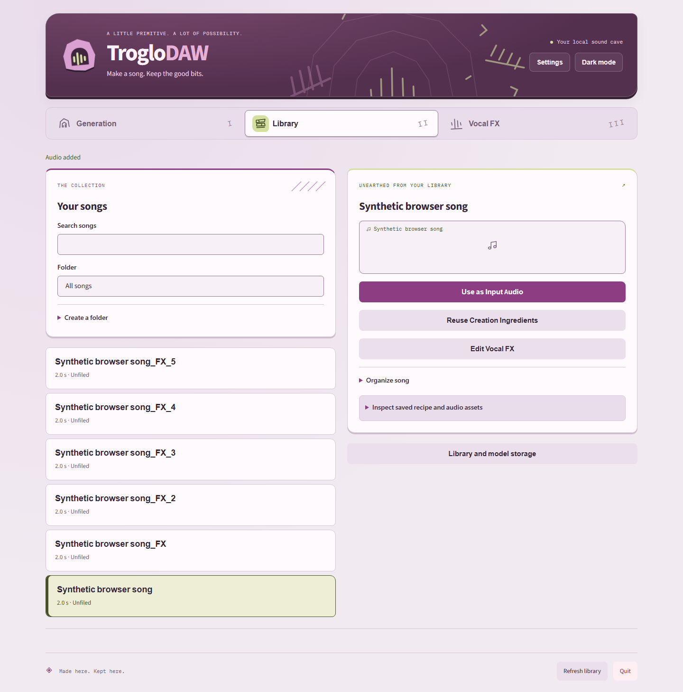
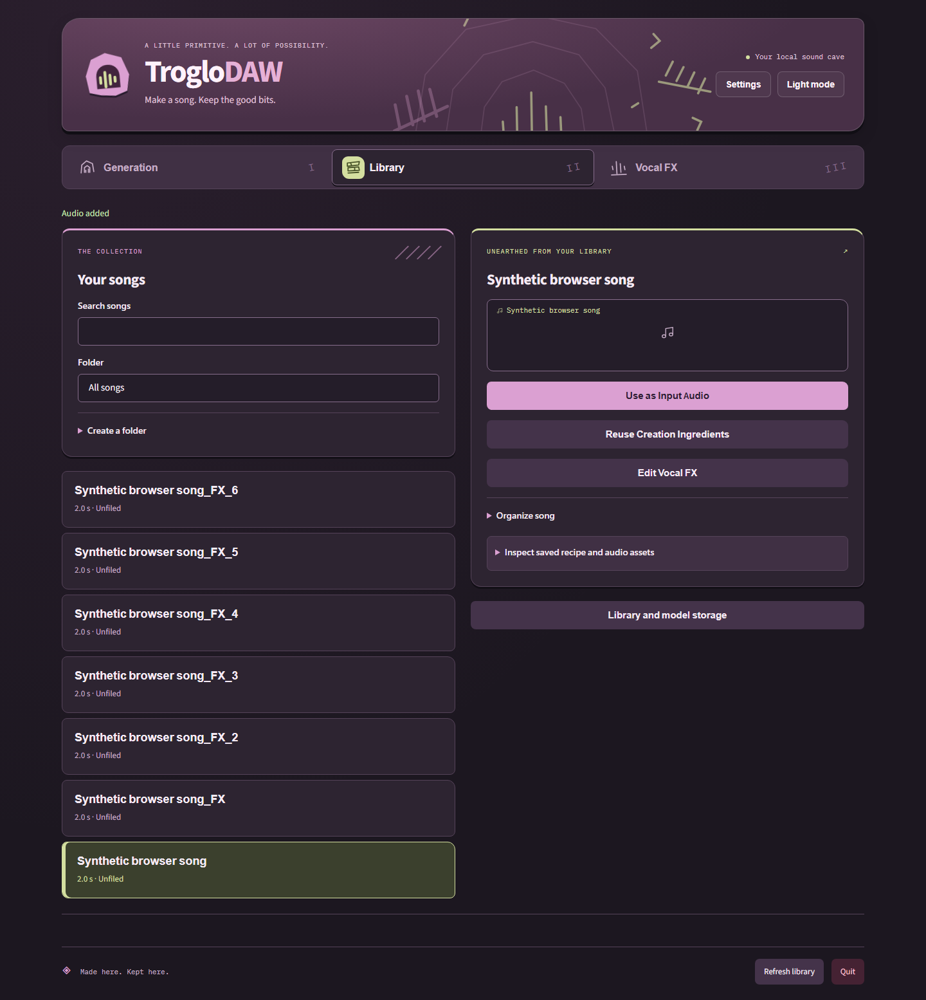
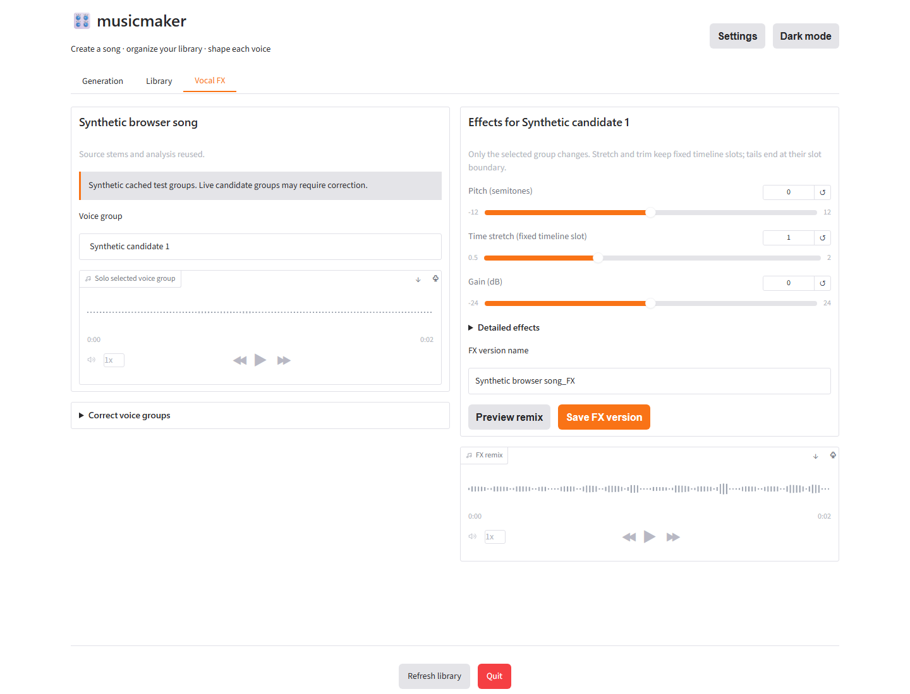
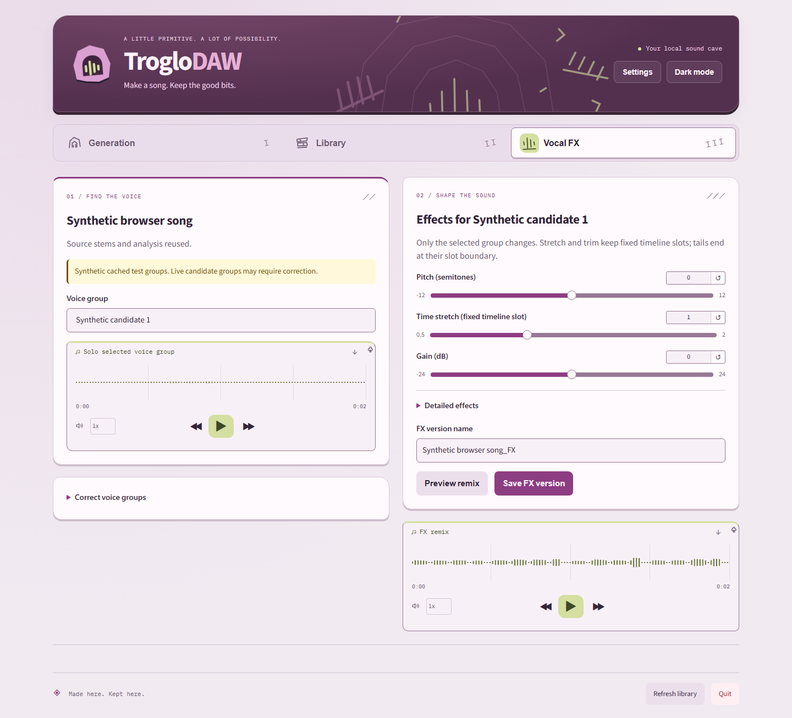
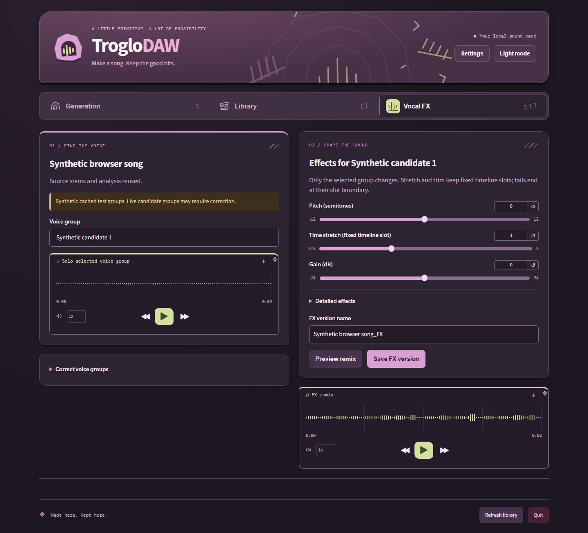

# TrogloDAW light/dark review evidence

Reference: [WRK-5 palette attachment](https://linear.app/magentumdragon/issue/WRK-5/pr-2-brand-troglodaw-across-the-app-and-docs-add-caveman-lightdark).
The provided pink-purple/lavender and pale lime image informed the cave-wall mural,
tally marks, carved workflow glyphs, stone strata and rhythm marks. Purple-family
accents predominate with deliberate lime playback/waveform/selection/setup accents.
Text/control derivatives are tuned for contrast.
These captures use the actual compiled frontend/FastAPI and explicitly synthetic
cached voice groups. Result captures use the real RTX 3070 model outputs from WRK-4.
No personal audio or model weights are committed.

## Before and after

The before captures are the three-workflow app from merged PR #3, before this
branding PR. The after captures show the final expressive design in this PR.
Fixture clip labels/selection vary; the workflow and controls are comparable.

| Workflow | Before branding | After: light | After: dark |
| --- | --- | --- | --- |
| Generation |  |  |  |
| Library |  |  |  |
| Vocal FX |  |  |  |

## Complete state gallery

| State | Light | Dark |
| --- | --- | --- |
| Initial setup | [light](light-setup.png) | [dark](dark-setup.png) |
| Generation default | [light](light-generation.png) | [dark](dark-generation.png) |
| Expanded options/Clip adjustments | [light](light-generation-expanded.png) | [dark](dark-generation-expanded.png) |
| Real model results | [light](light-results.png) | [dark](dark-results.png) |
| Library selection/player | [light](light-library.png) | [dark](dark-library.png) |
| Prior-song preset | [light](light-preset.png) | [dark](dark-preset.png) |
| Selective recipe ingredients | [light](light-reference.png) | [dark](dark-reference.png) |
| Vocal FX default | [light](light-vocal-fx.png) | [dark](dark-vocal-fx.png) |
| Expanded correction/effects | [light](light-vocal-fx-expanded.png) | [dark](dark-vocal-fx-expanded.png) |
| FX save choice | [light](light-save-choice.png) | [dark](dark-save-choice.png) |
| Microphone permission recovery | [light](light-recording-error.png) | [dark](dark-recording-error.png) |
| Narrow Generation | [light](light-narrow.png) | [dark](dark-narrow.png) |

Desktop viewport: 1440 x 1100; narrow: 390 x 844. More Options remains collapsed
by default with exactly five requested controls. Detailed sample/FX/recipe/setup
choices remain progressively disclosed. The same draft/actions work in both modes.

Seven real-backend browser tests cover the existing workflows plus system-first
appearance, saved overrides/reload, return to system/live changes, waveform repaint,
selection semantics and narrow layout. The theme test runs axe-core WCAG A/AA
checks against Generation, Settings, selected Library and Vocal FX in both modes,
plus a narrow workflow. All checks passed; this automated scope does not claim an
exhaustive accessibility certification. Native tests repeat the seven browser
flows and verify branded metadata/shortcut migration, retained custom entries,
matching installer aliases, compatible mm.bat, upgrades and model-removal choices.
