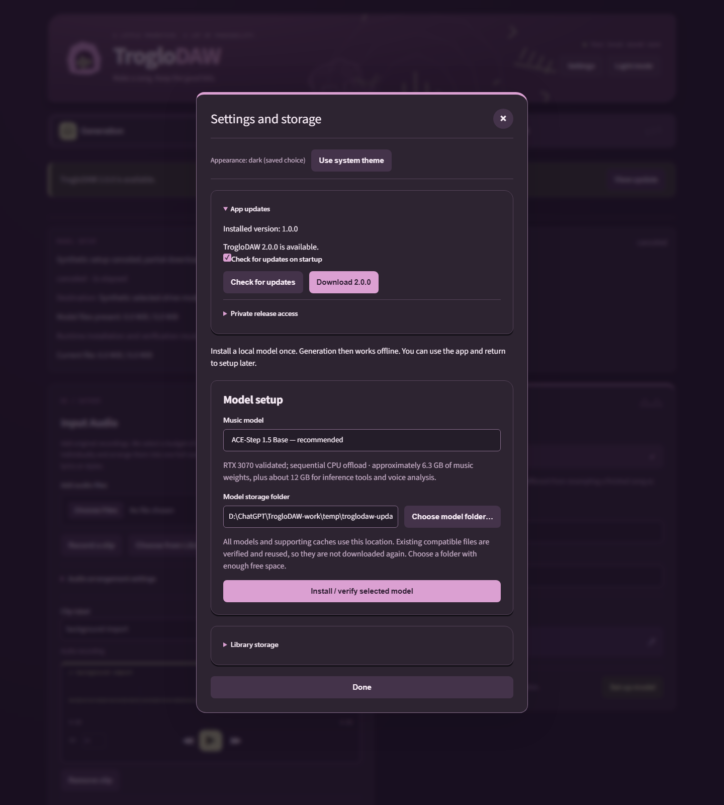

# App updates

Installed Windows builds check the latest stable GitHub release in the background on startup. Audio, lyrics, generation and your library remain local. Release checks send no song data. Offline access failures do not prevent normal use.

Open **Settings → App updates** to check manually or turn startup checks off. An available-version notice opens these controls. **Download** is explicit and shows actual bytes and a transfer estimate; you can cancel and retry. The app verifies the canonical installer against its release manifest, checksum, source tag and asset size before offering **Install update and restart**.

**Open latest release in browser** uses your normal browser login for manual
downloads. It needs no CLI or separately entered token when that browser already
has repository access. The app's background Python requests cannot reuse browser
login cookies, so verified in-app checking/downloading still needs release access
for a private repository. Successful checks show the access source in Settings.
Checks discover releases; downloading and installing remain explicit actions.

Clicking **Check for updates** immediately shows **Checking for updates…** while
credentials and release access are pending, then reports a newer release, an
up-to-date result or an access error. A failed status read appears in Settings and
clears when polling recovers; expected installer handoff interruptions stay quiet.

Installation waits for processing, uploads, folder selection and recording in every app tab to finish. The update helper acknowledges its plan before TrogloDAW stops, runs the verified installer against the existing installation, and restarts the app on the same localhost port. A status page replaces the controls during installation; it returns to the app after restart. Models, library folders and installation preferences—including completed or deferred initial setup—are reused. Existing desktop and Start Menu shortcuts are kept untouched so their placement and customization survive; missing shortcuts are restored.

Interface example captured from the real app against synthetic release/installer boundaries; the displayed versions are illustrative.

## Private release access

Public releases can be accessed without credentials. If private release access is needed, the app tries a token saved through **Private release access**, an explicit `TROGLODAW_GITHUB_TOKEN`, then the active GitHub CLI login, before public access. GitHub CLI is optional. The app does not prefer named accounts, enumerate other logins or switch accounts; select the intended active login in GitHub CLI or supply release access explicitly. A fine-grained token needs read access to repository **Contents**. Save tokens only through the password field; they are stored in Windows Credential Manager for this installation, never in JSON preferences or song recipes. Uninstall removes this installation's saved access even when models are retained. Credentials are stripped from redirects to other approved download hosts.

The CLI's active account is tried once, without changing its selection. Windows
checks look in standard GitHub CLI and WinGet installation locations if the
desktop process inherited a PATH from before the CLI was installed. Source builds
show their development status and use Git/rebuild or manual browser downloads;
in-app installation applies only to installed Windows releases.

## Recovery and limitations

New releases download as `TrogloDAW-Setup-<version>.exe` (for example,
`TrogloDAW-Setup-2.4.0.exe`) so several installers can be kept together. The updater
prefers the exact versioned asset and still verifies historical releases that
only contain `TrogloDAW-Setup.exe`.

Apps released before this filename change only recognize `TrogloDAW-Setup.exe`.
For the first upgrade, download the versioned installer, SHA256SUMS and
release.json from the same [stable release](https://github.com/dalehayesiii/TrogloDAW/releases/latest).
Verify its SHA-256 with `Get-FileHash -Algorithm SHA256` against the matching
SHA256SUMS entry and confirm release.json names the same file/version. Finish
active work, close TrogloDAW, then run that installer against the existing app
location. Keep your configured library/model folders. Confirm the new version in
Settings; later releases use in-app updates normally. If repair or rollback is
needed, retain the downloaded verified installer and follow
[installation and data recovery](installation-recovery.md).

Download, verification or helper launch failures leave the current app running. Retry the operation after resolving connection, disk-space or access issues. Downloads/helpers use the selected model drive; a controlled sibling cache is used if that location is inside the installation directory.

If the helper rejects an installer or plan before the original app has stopped,
it records the failure and exits promptly without opening a temporary status
listener. A free port does not turn a rejected preflight into an update session.
After the validated original app has stopped, failed installation or restart keeps
the recovery status listener when its port is available.

If native installation fails after handoff, the status page identifies the verified installer retained on disk. Run it to repair the same installation or reopen TrogloDAW from its shortcut when its files remain usable. Binary rollback is not automatic. Keep your existing library/model folders; see [installation and data recovery](installation-recovery.md).

Source/development builds and unsupported platforms show their status explicitly and do not run installed Windows upgrades. Prereleases are excluded. The installer follows the repository's existing unsigned distribution policy; checksum/source verification does not claim code signing.
